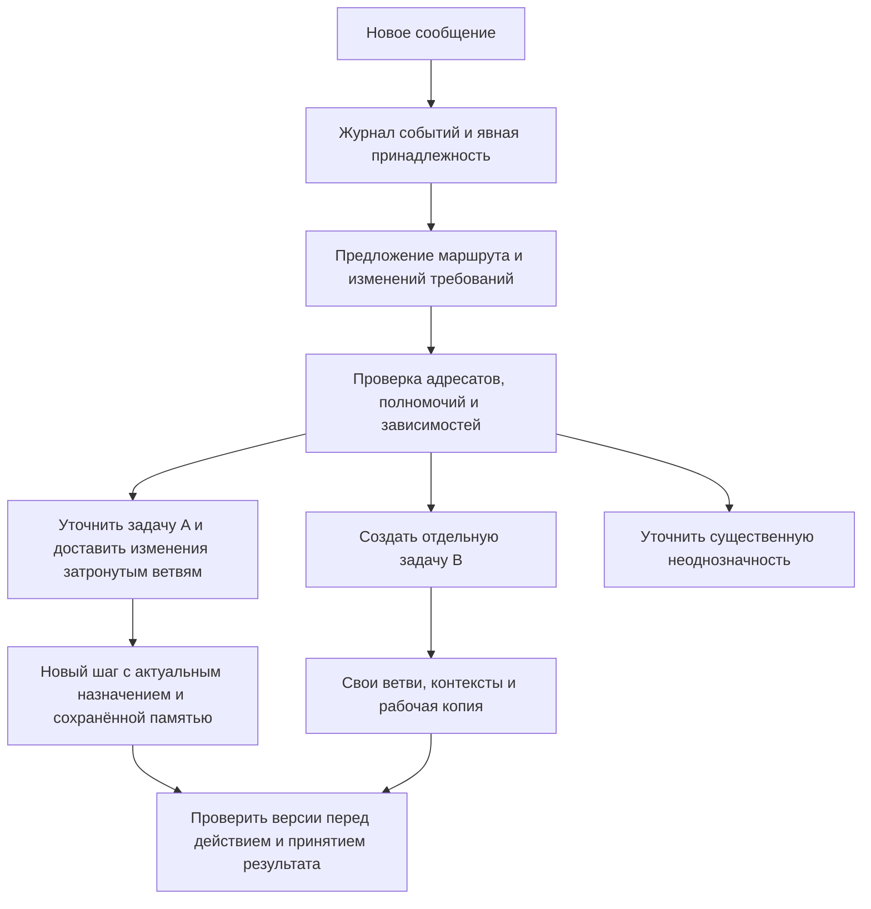

# Уточнение задач во время параллельной работы

Статус: **предложено**, 06.11.2026. Это проект следующего слоя, а не описание уже
реализованного Router. Он продолжает [разбор DSH](../dsh_superagent_adoption.md).

Сравнение с Pi, LangSmith, Codex и двумя исследованиями, а также первый живой прогон
разбора сообщений: [исследование и результаты 06.11.2026](../refinement_research_20261106.md).
По нему требуется отдельно представлять изменение требований, момент доставки и
управление выполнением. Прототип оценщика не является реализацией этого ADR в рабочем API.

Цель: принимать сообщения во время выполнения задач, направлять изменения нужным
участникам и сохранять пригодные результаты. Один разговор может содержать несколько
задач; внутри каждой работают отдельные ветви с собственными профилями и потомками.
Бюджет ограничен, выполнение облачное; новый слой не требует постоянного LLM-опроса.

## Основание в текущем коде

- `SessionControl.post/instructions/version` доставляет указание одному адресату и
  его потомкам. Адрес `main` наследует всё дерево; версия — число применимых сообщений.
  Семантическое разделение нового сообщения на уточнение и отдельную задачу отсутствует.
- `MindScheduler` сохраняет память при смене профиля, ограничивает число узлов и слоты.
  `group` ожидает всю группу. `Orchestrator.cooperation` передаёт краткие статусы и
  проверенные по происхождению находки; частные переписки остаются отдельными.
- `ObligationGraph` хранит требования, выводы и зависимости. Сейчас смена версии
  контракта/steering делает старые выводы устаревшими широко, даже если смысл отдельного
  требования не изменился. Это консервативное поведение сохраняем до проверки замены.
- Основной цикл и `run_mind` проверяют версии после генерации. Это основа защиты от
  исполнения ответа, построенного до новых указаний, но не полная транзакционная
  защита всех долгих инструментов от изменений, пришедших во время исполнения.

## Разделение сущностей

**Разговор** хранит общение с человеком. **Задача** имеет цель, требования, разрешения,
бюджет, зависимости и состояние. **Ветвь** выполняет конкретное назначение внутри задачи.
**Профиль** задаёт стратегию и доступное подмножество инструментов этой ветви; смена
профиля не создаёт автоматически новую задачу или новые полномочия. **Артефакт/находка**
содержит результат, его происхождение и версии зависимостей.

Создавать все профили для каждой задачи необязательно. Ветка появляется для отдельного
проверяемого результата или различающей проверки гипотезы. Уже полученный результат
переиспользуется; ветвь без новых действий и без нужного входа засыпает, а не опрашивает
остальных. Разные названия ролей сами по себе не обеспечивают независимость ошибок.



## Как разобрать новое сообщение

Одно сообщение может содержать несколько намерений: «сохрани API; ещё подготовь
сравнение библиотек». Исходный текст и авторство сохраняются целиком. Разбор предлагает
несколько связанных операций; исполнение не должно терять вторую просьбу.

| Связь с текущей работой | Действие | Пример |
|---|---|---|
| Уточнение существующего требования | Изменить требование и адресно доставить дельту | «Обрабатывай также пустой ввод» |
| Замена решения или требования | Явно пометить старое решение заменённым, пересмотреть зависимые результаты | «Используй SQLite вместо PostgreSQL» |
| Дополнительный результат в той же задаче | Новое назначение существующей ветви или отдельная ветвь | «Добавь инструкцию миграции» |
| Самостоятельная задача | Новая задача с отдельным состоянием | «А ещё подготовь учебный план» |
| Задача, которой нужен текущий результат | Новая задача с зависимостью от версии артефакта | «После этого сравни скорость до и после» |
| Остановка, приоритет или ответ на вопрос | Адресная операция управления | «Останови миграцию, остальное продолжай» |
| Неясная существенная связь | Сохранить событие и задать один вопрос | «Переделай это», когда активны несколько подходящих задач |

Явный `task_id`, ответ на конкретный вопрос и известный источник события дают быстрый
маршрут кодом. Определение смысла свободного текста может требовать короткого вызова
модели. Ей передаются компактные карточки кандидатов; детализация доступна по ID.
Общий проект или похожие слова не доказывают, что две просьбы имеют одну цель.

Результат модели — типизированное предложение с существующими ID, ссылками на фрагменты
исходного сообщения и причиной выбора. Runtime проверяет ссылки, область полномочий,
допустимость операций и бюджет. Оценка уверенности модели не считается калиброванной
вероятностью корректности. При неоднозначном изменении с существенными последствиями
запрашивается уточнение; сама неопределённость не разрешает расширять задачу.

## Изменения и зависимости

Каждое требование получает стабильный ID и собственную версию. Ветвь хранит версии
требований своего назначения, использованных артефактов, исходников и ограничений.
Связи требований и результатов дополняют существующий `ObligationGraph`.

При изменении `r-api:2 → r-api:3` runtime находит подписанные назначения и транзитивно
зависимые результаты. Требующие перепроверки выводы помечаются устаревшими, а независимые
наблюдения сохраняются. Изменение прав или общего ограничения относится ко всей области
его действия. Модель не вправе сузить такой охват своим выбором адресатов.

Полнота зависимостей не гарантирована: модель может не указать важную связь. Поэтому
отсутствие ребра само по себе не доказывает независимость. Для неполного учёта или
неясного влияния остаётся широкая инвалидизация в соответствующей задаче. Точечный
режим сначала проверяется на размеченных сценариях, а не включается как оптимистичное
значение по умолчанию.

Общая ревизия задачи служит журналу и проверке конечного результата. Разрешение очередного
действия проверяет версии именно его назначения, ограничений и зависимостей, иначе
любое изменение снова отменяло бы работу всех ветвей. Завершение всей задачи требует
покрыть текущую полную версию требований; завершение одной ветви этого не доказывает.

## Что получает ветвь

В следующем запросе собирается пакет из текущего назначения, неизменяемых ограничений,
дельты требований, отменённых предположений, ещё пригодных результатов и ссылок на
нужные доказательства. Полная история чужой ветви туда не переносится. Новая ветвь
получает такое же назначение с минимальным handoff, а не только абстрактную роль.

Пример дельты для реализации:

```json
{
  "event_id": "user-event-42",
  "task_id": "A",
  "task_revision": 8,
  "assignment_id": "A-implementation",
  "changed_requirements": [{"id": "r-api", "from": 2, "to": 3}],
  "user_text": "Сохрани прежний публичный API; внутреннюю реализацию менять можно.",
  "superseded_assumptions": ["Можно переименовать публичную функцию"],
  "next_obligation": "Сверить публичную сигнатуру и обновить план изменения",
  "evidence_refs": ["A/evidence/17"]
}
```

Тот же исходный запрет приходит проверяющему, но с его назначением: проверить совместимость.
Авторство пользователя отделяется от пояснения маршрутизатора и от находок других
агентов. Модель не может присвоить своей рекомендации авторитет пользовательского указания.

## Доставка во время генерации и работы инструментов

Для текущего протокола новая инструкция применяется при сборке следующего запроса.
Серьёзное изменение может отменить ожидание старой генерации; её поздний результат
всё равно не исполняется, если версии назначения уже изменились. Неблокирующие сведения
можно объединять для следующего шага. Противоречащие поправки сохраняются в журнале и
получают явную связь замены, а не молча склеиваются в одну строку.

Отмена соединения не всегда останавливает вычисление и оплату на стороне провайдера.
Поэтому приём поправок не должен автоматически перезапускать все генерации при каждом
сообщении. Поддержка остановки зависит от провайдера и streaming-режима.
[OpenRouter: stream cancellation](https://openrouter.ai/docs/api_reference/streaming#stream-cancellation).

После записи принятого изменения gate запрещает затронутым ветвям начинать новые
изменяющие операции со старой версией. Пока адресное влияние существенного уточнения
разбирается, затронутая известная задача удерживает приём правок и завершение. Это
не обещает остановить уже начавшуюся операцию. Её результат сохраняется с исходной
версией; перед повтором/интеграцией нужно проверить, что действительно произошло.

Проверка версии и допуск изменяющего действия выполняются через один сериализованный
gate, а не разделяются произвольным `await`. Долгую команду нельзя держать под общей
блокировкой диспетчера: регистрируется начатая операция, а её итог сверяется отдельно.
Изолированная правка остаётся кандидатом до интеграции; неизвестный внешний эффект
получает статус `needs_reconciliation`, без автоматического повтора или отката.

Сохранение состояния само по себе не обеспечивает однократное выполнение внешних
эффектов. Это также существенная оговорка при interrupt/resume в существующем LangGraph:
возобновление может повторять код узла, поэтому нужны идемпотентные операции или
дедупликация. [LangGraph: interrupts](https://docs.langchain.com/oss/python/langgraph/interrupts#side-effects-called-before-interrupt-must-be-idempotent).

## Минимальная реализация

Предлагается один локальный диспетчер и компактный журнал управления в SQLite; текущие
файлы evidence, рабочие копии и checkpoint остаются на месте. Транзакция сохраняет
событие, изменения задачи и список адресатов доставки. ID события уникален: повторная
доставка с тем же содержимым не создаёт новую работу, с другим — отклоняется. После
перезапуска недоставленные события воспроизводятся; внешние эффекты требуют отдельной
сверки. Никакой сети микросервисов или дополнительного inference-процесса для ожидания.

Диспетчер и реестр задач добавляются над `CodingHarness`. Версии и доставка развивают
`SessionControl`; зависимости — `ObligationGraph`; пакеты — существующий сборщик
контекста. Router управляет задачами, `Orchestrator` — ветвями одной задачи. Внешние
веб-данные и сообщения других агентов остаются данными с ограниченными правами.

Общий планировщик должен ограничивать слоты и бюджет **между задачами**, включая
router/critic, а не выдавать каждой новой задаче полный независимый бюджет. Приоритет
новой просьбы не должен бесконечно вытеснять старую: нужны очередь, старение приоритета
и видимый статус ожидания. Зависимые проверки ждут конкретный артефакт, освобождая слот.
Пишущие работники используют отдельные копии, интеграция сериализуется по проекту.

## Этапы и критерии принятия

1. **Адресные изменения одной задачи.** События с ID, версии требований/назначений,
   доставка нескольким адресатам, квитанции контекста и защита от старых действий.
   Сохранить широкую инвалидизацию как fallback.
2. **Несколько задач одного пользователя.** Журнал, явные задачи в API/UI, продолжение
   после перезапуска, общий бюджет и очередь. Сначала ручная привязка задачи.
3. **Семантический разбор.** Типизированные предложения маршрута, разделение составных
   сообщений, выборочное уточнение и локальная оценка на размеченных примерах.

Проверить: уточнение одного требования; изменение общего ограничения; два намерения
в сообщении; независимый B при работающем A; B, ожидающий артефакт A; отмену одной ветви;
поправку во время генерации и во время команды; повтор события; перезапуск между
сохранением и доставкой; пропущенную зависимость; приход старого результата после
новой версии; справедливость очереди и общий расход при нескольких задачах.

Жёсткие условия: устаревшее действие не проходит gate; повтор события не удваивает
работу; завершение не пропускает актуальное требование; неизвестная зависимость не
признаётся безопасной автоматически. Измерять корректность маршрута/полноту охвата,
лишние прерывания, задержку доставки, утраченные требования и внешний успех задачи
при одинаковом денежном бюджете. Сравнить с текущей широкой рассылкой. Оценка самого
Router и число зелёных unit-тестов не заменяют эту проверку.

Шардирование Router, отдельный Watchdog-процесс, несколько пользователей и удалённые
исполнительные устройства пересматривать только после измерения нагрузки и появления
этих требований. Контексты одной сессии сейчас не являются границей доступа разных
пользователей; новый журнал сам по себе такой границы не создаёт.
