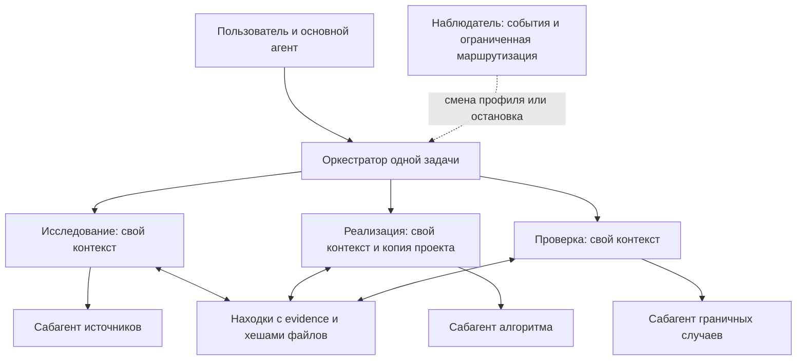

# Доводка результата и идеи DSH Superagent

## Дополнение 05.11.2026: параллельные режимы

Полный текст [Exploring Super-agent Design](https://x.com/DeepSeekHarness/status/2116857257245987236)
предоставлен пользователем; прямой доступ к X возвращал 403. Статья описывает архитектурные
идеи, не список готовых возможностей продукта. Публичный прототип реализует только часть.

Важное разделение: Router из статьи координирует **разные задачи и каналы**, а наш
`Orchestrator` организует **ветви одной задачи**. Его `DecisionRouter` выбирает стратегию,
но не является постоянно работающим глобальным Router. Внутри Worker из статьи может
находиться именно такое дерево ветвей. Подменять один уровень другим нельзя.

**Что работает.** Ветви запускаются через `asyncio.gather`; каждая может создавать
потомков и завершает своё задание независимо от соседей. Слот удерживается только на
время генерации, поэтому ожидающий потомка родитель не блокирует его доступ к модели.
В `config.yml` теперь `cloud_slots: 2`, `local_slots: 1`. Это два одновременных облачных
вызова рабочих ветвей, а не две локальные модели. Внешние router/critic имеют отдельные
лимиты; это не глобальный потолок всех HTTP-запросов. Старые конфиги без `cloud_slots`
сохраняют значение `local_slots`. Бюджеты денег, токенов, узлов и глубины не увеличены.
Сравнительные скрипты явно сохраняют один слот для сопоставимости экспериментов.

**Обмен контекстом.** `share` теперь доступен исследующим и проверяющим ветвям, без
разрешения на правку исходников. На следующем шаге ветвь получает до шести компактных
статусов родителя/соседей/прямых потомков и две свежие валидные находки от них; остальные
находки доступны через `context`, полные результаты — через `evidence`. Публикация не
отменяет текущий платный вызов и не запускает дополнительный LLM-диспетчер. В квитанции
контекста записываются ID реально переданных соседей и находок. Это учёт передачи,
не доказательство того, что модель поняла информацию.

Исправлена привязка опубликованной находки к исходникам: хеши берутся из копии
**автора**, а актуальность проверяется в копии **читателя**. Одинаковое имя файла в двух
ветвях не означает одинаковое содержимое. Автор определяется runtime, а не аргументом
модели; публикация через доску другой сессии отвергается. Полные личные переписки ветвей
не объединяются, однако их опубликованные результаты намеренно доступны участникам
той же сессии. Это изоляция рабочего контекста, не граница доступа между разными пользователями.

**Переключение и завершение.** `think` меняет профиль самой ветви; оператор или
существующий наблюдатель могут адресно переключить/остановить ветвь. Память остаётся,
поколение меняется, устаревшая генерация не исполняется. Соседняя ветвь не получает
права командовать другими только потому, что опубликовала текст. Отмена группы теперь
сохраняет дочерние статусы `interrupted`, а не оставляет их формально работающими.

**Границы.** Основной цикл пока ожидает результат группы делегатов. Это fork/join,
не полноценный full-duplex Router с фоновыми заданиями `start/stop`. Независимые части
проверки можно вести параллельно, но проверка новой правки требует получить актуальную
версию: изолированные копии не синхронизируются автоматически. Принятие патчей и
проверки в родительской копии сохраняются. Нет глобального сервиса Triggers/Threads,
подписок GitHub/IM, облачного демона на личных устройствах или отдельного Watchdog-процесса.
Наблюдатель внутри процесса не переживёт его падение. Новые механизмы не включают
спекулятивную работу без задания и не публикуют сообщения во внешних каналах.

В статье время завершения в синтетическом эксперименте улучшилось, но кодирование
имитировалось задержкой. Несколько сессий также увеличили число cache-read tokens по
сравнению с одной сессией. Это аргумент за ограниченную конкуренцию и дешёвую передачу
событий, а не доказательство повышения SWE-bench или превращения 10B в сильнейшую модель.

Регрессии `tests/test_parallel_minds.py` исполняют параллельные генерации с управляемой
моделью, вложенные группы, отмену, передачу находки на следующем шаге и отбраковку
устаревших хешей. Файловые операции и планировщик настоящие, LLM-ответы подменены;
прирост качества облачной модели здесь не измеряется. Логи:
`data/eval/parallel-minds-20261105/`.

Итог проверки этого дополнения: целевые регрессии **43 passed**, весь набор
**1333 passed, 3 skipped** (12 предупреждений об устаревающих API). Новых платных
прогонов и обучения не запускали. Целостность исходников проверена после адресного
обновления семи изменённых записей; предыдущая база сохранена рядом с логами.

Разобран `deepseek-ai/dsh-superagent-prototype`, commit
[`6337fc823ce20251c8de8085948165c81aaa701e`](https://github.com/deepseek-ai/dsh-superagent-prototype/tree/6337fc823ce20251c8de8085948165c81aaa701e), 2026-11-01.
Репозиторий получен отдельно, его установщик и команды не запускались.
Это исследовательский прототип командного агента для GitHub/Feishu, а не готовый универсальный решатель.

## Что перенесено и адаптировано

| Механизм | Источник DSH | Реализация здесь |
|---|---|---|
| Ожидание человека — структурированные данные, не догадка по тексту | `src/core/stage.ts`, `src/core/assignments.ts` | `completion.state`, `human_action`, отдельная `availability` проверки. Слово `unavailable` в замечании о продукте больше не останавливает цикл как сбой критика. |
| Один конкретный вопрос, сохранение до разрешения, повторное использование ответа | `prompts/handoff-worker.md`, `src/core/replies.ts` | `ask_user`, `attention-<owner>.json`. Нет ответа — нет допущения. Ответ приходит из интерфейса или ссылается на новое реальное сообщение оператора. Дочерний агент передаёт вопрос родителю. |
| После прерывания сначала проверить фактическое состояние | `src/core/assignments.ts`, `RECOVERY_NOTE` | Checkpoint сохраняет намерение и сигнатуру незавершённой операции. Resume показывает её агенту и отклоняет точный повтор до наблюдения состояния. Это не гарантия exactly-once внешних действий. |
| Законченный ход не означает готовый результат | `docs/003-execution.md`, `prompts/work.md` | Успешный финал проходит существующие проверки и критика. Незавершённый запуск возвращает причину, оставшуюся работу и checkpoint. |
| Меньше запросов к человеку, узкий контекст следующего шага | `docs/000-philosophy.md`, `src/app/assessment.ts` | До шести нерешённых критериев, один текущий шаг, критерий его проверки и подходящий режим. Используется существующий вызов критика, отдельная модель-планировщик не добавлена. |

Это самостоятельная Python-реализация механизмов; исходные TypeScript-модули и их промпты целиком не копируются.
У DSH лицензия MIT, автор — DeepSeek Harness Team. При дальнейшем копировании существенных фрагментов нужно сохранять его уведомление об авторстве и лицензию.

### Дополнительная проверка через Codex CLI

2026-11-01 проверен официальный `codex exec` с уже существующим входом пользователя через ChatGPT:
без OpenRouter, локального инференса и извлечения токенов авторизации. Использованы временный рабочий
каталог, read-only sandbox, отключённый shell, структурированный ответ и таймаут 60 секунд.
В журнале обоих запусков нет вызовов инструментов. Это доступ аккаунта пользователя, не отдельный API-ключ.

Синтетический пример воспроизводит преждевременное «готово»: нечитаемый PDF, один титульный слайд
вместо четырёх с диаграммой, отсутствующий сервис. Модель отвергла готовность и предложила три действия.
Первый ответ не прошёл строгую проверку ссылок: первоначальная схема **тестового адаптера** допускала
описания вместо ID доказательств. Вторая схема использует ограничения ID, уже имеющиеся в рабочем
критике. После этого `Assessment`, `ObligationGraph` и `agenda` приняли ответ и сохранили три незакрытых
требования. Первый неуспешный ответ сохранён, проверки не ослаблялись.

Артефакты: `data/eval/codex-followthrough-smoke/`, итог `result.json`, повторяемый запуск `run.py`.
Два вызова CLI суммарно сообщили 34 938 токенов; успешный занял 17,88 с. Большой собственный контекст
Codex делает этот способ пригодным для диагностики, но не доказывает экономичность рабочего backend.
Это проверка критика и очереди доводки, **не** полный цикл исправления, не прогон Flash и не бенчмарк.
Продуктовый backend не переключён. Официальный интерфейс:
[Non-interactive mode](https://learn.chatgpt.com/docs/non-interactive-mode).

## Как теперь проходит доводка

1. Контракт сохраняет цели и все именованные выходные файлы. У группового требования есть `path` и `paths`: проверка первого сервиса не подменяет проверку второго. Пути привязаны к исходному запросу. Ошибочный контракт исправляется в уже существующем ограниченном цикле коррекции схемы.
2. Дешёвые проверки находят отсутствующие результаты. PDF должен открываться, PPTX сообщает число слайдов, формат и диаграммы, JSON должен разбираться. `build.py` с нулевым кодом выхода не доказывает существование документов.
3. Критик связывает замечание с `r-id` и возвращает `next_steps`: проблема, конкретное действие, режим, проверяемый результат. Эти данные сохраняются вместе с требованиями.
4. Следующий ход получает конкретный незакрытый пункт. При актуальном замечании выбирается подходящий режим; ручной выбор пользователя и ограничения инструментов сохраняют приоритет. После правки старое замечание требует перепроверки, а не слепого повторения ремонта.
5. Для настоящей неоднозначности агент вызывает `ask_user`. В интерфейсе используется существующее окно уточнения; в интерактивном терминале — ввод ответа. Без канала/ответа возвращается `needs_input` и сохраняется вопрос. Следующее сообщение при `resume` дополняет исходную задачу.
6. Результаты и причины остановки записываются в отчёт. Бюджеты, число вызовов и ограничения окружения не увеличиваются.

Форматные проверки кешируются по содержимому файла, исполняются изолированно, без сети, с лимитами времени и размера. Это метаданные для проверки: один валидный титульный слайд всё ещё не выполняет требование о четырёх содержательных слайдах. За смысловое соответствие отвечает критик и конкретные проверки задачи. В удалённых backend без Python-probe остаётся только проверка существования с явным ограничением.

## Что уже было и что не переносилось

Изоляция контекста дочерних агентов, границы полномочий, защита от устаревшей генерации, журнал траекторий, ограничение бюджета и адресованные сообщения уже были в движке. Они сохраняются; смена промпта не выдаёт новые права.

DSH использует durable outbox, источники событий GitHub/Feishu, отдельные слоты работников и фоновые shell jobs. Это полезно для командного сервиса, но здесь не добавлены внешние подписки, публикация сообщений, автомерж или второй планировщик заданий. Режим запуска shell с правами пользователя ОС из DSH также не переносится: наша песочница остаётся обязательной. У нас вопросы пока приостанавливают основной ход, а не запускают независимые части задания в фоне; это явное отличие от DSH.

## Проверка и границы результата

`tests/test_followthrough.py` воспроизводит потерю второго файла в контракте, PDF-заглушку, пустую презентацию, устаревание свидетельств, уточнения без ответа, продолжение с ответом, передачу вопроса родителю и прерывание после фактически выполненной записи. Сквозной тест проверяет цепочку: отказ критика → режим repair → реальная правка → исполнение проверки → завершение.

Модели в регрессионных тестах заменены управляемыми ответами; файловая система, парсеры и проверочные процессы настоящие. Это подтверждает работу механизма, но не прирост качества Flash/9B. Повторный прогон Flash через OpenRouter не выполнен: последний запуск остановился с HTTP 402. После описанной выше проверки критика проведены [шесть живых сценариев через Codex CLI](behavior_validation.md): полный цикл инструментов, найденные ошибки, исправления и ограничения оценки описаны отдельно.
