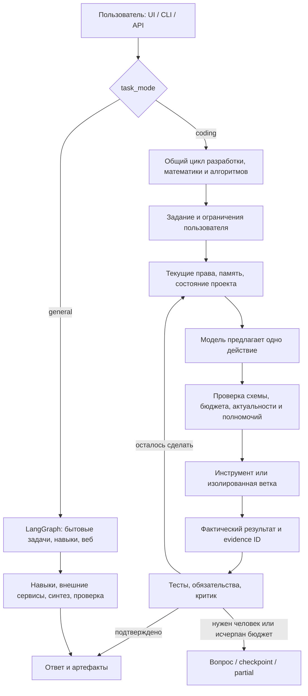

# SEA: полный разбор конструкции и границ качества

5 ноября 2026. SEA — уже исполняемая агентная система: она умеет ставить проверяемые подзадачи, работать инструментами, сохранять состояние и проверять результат. Её сильная сторона — контроль исполнения. Главная слабость — недостаток сопоставимых измерений того, какие дополнительные механизмы действительно помогают выбранной малой модели. Полезность отдельных частей подтверждена лучше, чем качество их совокупности.

Это техническая ревизия текущих исходников и локальных результатов, а не заявление о построчной формальной верификации. В `src` проиндексированы **199 Python-модулей, около 36,9 тысячи строк**, включая комментарии. Ядро `coding` занимает 51 модуль и около 9,2 тысячи строк. [Карта каждого модуля](harness_module_map.md) содержит назначение, размер и ссылку на исходник. В `data/eval/harness-audit-20261105/inventory.json` сохранены хеши, классы, функции и их номера строк.

## 1. Что на самом деле является агентом

В проекте два контура. Публичный `src.harness.Harness` — алиас `CodingHarness`, а не третий движок.

В веб-интерфейсе новый сеанс по умолчанию выбирает coding; API-модель запроса по умолчанию задаёт general. Это реальное различие точек входа. Успех одного контура не доказывает качество другого. Разные маршрутизаторы, память и правила бюджетирования требуют отдельных измерений.

## 2. Цикл исполнения по шагам

1. `interface/server.py`, `coding/cli.py` принимают задачу, workspace, reasoning, execution и resume. Блокировка workspace не позволяет двум независимым coding-запускам одновременно писать в один проект.
2. `harness.py` открывает checkpoint, восстанавливает план и заметки. Старое прохождение тестов не переносится как актуальная гарантия.
3. При включённой оркестрации `critic.py` выделяет контракт: требования, формат ответа и критерии. `contract_sources.py` привязывает механические требования к настоящим фрагментам пользовательского текста. Модель не должна самовольно требовать лишние файлы или тесты.
4. `navigation.py`, `project.py`, `context.py`, `minds.py` собирают небольшой пакет состояния. `request.py` убирает дубли и укладывает его в окно. Обязательные инструкции сохраняются; при нехватке места следует ошибка, а не их тихое усечение.
5. `model.py` отправляет запрос в выбранный backend. `Turn` допускает план, инструмент, делегирование или завершение. JSON/schema/native-tools — способы доставки одного протокола.
6. Перед действием runtime проверяет текущую версию указаний, разрешённый набор действий, изменения прочитанных файлов, повторение и бюджеты.
7. Инструмент исполняется в контролируемом окружении. Настоящий результат записывается на диск; выданный моделью план ещё не считается выполнением.
8. Ошибки обновляют фокус сбоя, изменения файлов сбрасывают старую верификацию. `followthrough.py` выбирает конкретный незакрытый критерий и следующий способ его проверить.
9. `finish` — предложение модели. Успех допускается только после предусмотренных проверок. Иначе следует новый шаг, вопрос человеку или честный частичный результат.

## 3. Модель, reasoning и режимы работы

| Элемент | Что реализовано | Существенный нюанс |
|---|---|---|
| Backend | OpenRouter, llama.cpp, локальный совместимый backend | Текущий coding-профиль облачный; локальный запуск не начинается сам |
| Reasoning | auto / low / medium / high | Усилие и лимит видимого ответа — разные параметры; provider может поддерживать их по-разному |
| Execution | auto / plan | Переключение мыслительной роли не отменяет запрет записи в plan |
| Роли | inspect, reason, plan, research, review, repair, implement, verify | Это инструкции, доступные инструменты и политика продолжения; веса модели не переключаются |
| Динамический профиль | Ограниченная схема `ProfileSpec`, правила, tool ceiling | Генерация промпта не выдаёт новых полномочий |
| Decision routing | JEV Decisions API, ограниченный planner; другой backend по конфигу | Это отдельные запросы и расходы, а не бесплатная магическая оркестрация |
| same_model | Одна выбранная модель для нескольких ролей | Нужен для честного эксперимента «что может именно эта модель с обвязкой» |

В `config.yml`: основной актёр и критик — Gemini Flash Lite; навигация и decision routing используют JEV. `max_parameters_b: 10` имеет смысл для проверяемого локального backend, но не превращает облачный профиль в доказательство возможностей 10B. В общем LangGraph-контуре есть отдельные `model`, `code_model`, `deep_model`; выбор coding-модели не унифицирует весь продукт.

## 4. Сабагенты и наблюдатель

`MindScheduler` хранит дерево веток, поколения и рабочую память. Смена режима сохраняет контекст ветки, а новая ветка получает ограниченный handoff. Право инструмента получается пересечением текущего профиля и изначального потолка полномочий. Вложенность не умножает общий лимит бюджета.

`BranchStore` создаёт изолированные рабочие копии для пишущих веток. Родитель рассматривает предложение, проверяет конфликты и интегрирует его. Результат дочерней ветки не считается автоматически принятым изменением родителя. Общие findings сверяются с файлами той ветки, которая их читает.

По текущим настройкам: максимум 12 узлов с учётом основного за запуск, глубина 3, до 3 веток в одном разбиении, 16 шагов ветки, один слот локальной генерации и два облачных. Ветви получают компактные статусы соседей и могут публиковать находки во время работы. Это ограниченная конкуренция; родитель пока ожидает завершения группы. Подробности и ограничения — в [дополнении по DSH](dsh_superagent_adoption.md).

`Supervisor` собирает события, действия, доступный входной контекст, вывод и предоставленные провайдером reasoning-фрагменты. Он не получает скрытые внутренние состояния модели. Бесплатное наблюдение по событиям уже есть; платное review и маршрутизация имеют лимиты. `SupervisorPanel.tsx` показывает операционный статус и позволяет вмешаться.

В этой ревизии простой fallback-делегат получил настоящее ограничение схемы и исполнения до `tree/read/search/evidence`. Раньше текст обещал более узкую роль, чем общий runtime-набор readonly. Также устранено исполнение его ответа после нового указания, пришедшего без прерывания запроса.

## 5. Все ярусы памяти

| Память | Назначение | Чего она не доказывает |
|---|---|---|
| task + human steering | Оригинальная задача и последующие инструкции | Старый текст из retrieval не становится новым указанием |
| plan + notes | План и краткая сводка следующего шага | Успех ещё не выполненного инструмента |
| `WorkingMemory` | Изолированная память ветки, handoff, ссылки, прочитанные файлы | Семантическую истинность сводки |
| `FailureFocus` | Последний наблюдавшийся сбой с версией источников | Что прежний диагноз актуален после правки |
| `ResultMemory` | Ограниченный журнал успешных вычислений | Что выполнение команды на старом состоянии подтверждает новое |
| `ContextBoard` | Обмен findings с evidence IDs и хешами файлов | Что текст finding логически следует из доказательства |
| `ProjectContext` | Факты, гипотезы, процедуры, вопросы, предпочтения, ссылки | Личность пользователя и невыраженные предпочтения |
| `ExperienceStore` | Исторические примеры успешных проверенных эпизодов | Что предложенная процедура универсальна и безопасна |
| `ContextArchive` | Поиск по прошлым состояниям своего актёра и результатам | Текущие полномочия и актуальность прежнего прохождения тестов |
| `memory/*`, LightRAG, retrieval | Память общего LangGraph-контура | Что все правила coding-памяти автоматически распространяются сюда |

`single_action` оставляет сводку, актуальные ограничения и последнее наблюдение; остальное можно дочитать инструментом. Стандартный режим пока `bounded`. Это уже ограниченный контекст, поэтому сравнение с бесконечной историей дало бы нечестное представление о выигрыше.

В этой ревизии применено поэлементное слияние заметок: lock → прочитать актуальный индекс → обновить одну запись → атомарно сохранить. Независимые экземпляры больше не затирают соседние обновления. Чтение и navigation обновляют индекс. Повреждённый индекс не заменяется пустым при следующей записи.

Числовые evidence IDs теперь связываются с исходной сессией и хешем содержимого в shared/project/experience. Если файл пропал, изменился или заменён symlink, запись не попадает в подтверждённый retrieval. Legacy-записи без происхождения остаются на диске, но требуют повторного получения доказательств. Хеши проверяет runtime; модель не оплачивает их повторную передачу в каждом пакете.

Это защита целостности и происхождения, **не решение семантического отравления памяти**. Добросовестно сохранённый вредоносный текст тоже имеет правильный хеш. Записи остаются данными, а действия отдельно проверяются по полномочиям.

## 6. Инструменты и терминал

`worktools.py`, `terminal.py`, `edits.py` предоставляют модели read/search/grep/diff/status, точечные и пакетные правки, команды, проверки, эксперименты и работу с артефактами. Это инструменты самого агента, как и требовалось, а не только slash-команды интерфейса.

Python/C++/Node/Docker-навигация начинается с файлов проекта и команд сборки. `math` и `experiment` позволяют вынести точное вычисление из языковой модели. Это увеличивает возможности всей системы, но правильную постановку вычисления всё ещё должна предложить модель.

Команды изолируются от секретов и записи в работающий runtime. Отдельные разрешения нужны для сети и расширенной записи. Docker socket и привилегированные контейнеры не считаются обычной безопасной командой. Аргументы команд передаются структурированно; модель не получает произвольные привилегии из текста README.

## 7. Проверка результата

| Уровень | Механизм | Остаточный риск |
|---|---|---|
| Структура | Pydantic, action schema, scoped tools | Валидный JSON может задавать плохое решение |
| Выполнение | exit code, зарегистрированные проверки, реальные файлы | Неполные тесты пропускают дефекты |
| Соответствие задаче | Контракт, `ObligationGraph`, незакрытые критерии | Контракт и семантический review могут ошибаться |
| Независимая проверка | Изолированные probes, provenance тестов | Генерируемая проверяющая программа тоже ошибается |
| Численный ответ | Привязка вычисленных значений/свидетельств к точному JSON-ответу | Равенство ответа oracle не делает oracle математической теоремой |
| Документы | Существование и инспекция артефактов, формат и содержание | Существование PDF/PPTX не равно хорошей презентации |
| Финальный статус | done / planned / partial / ожидание / checkpoint | Нужны проверки реального пользовательского результата |

Разные механизмы ремонта oracle и тестов появились из конкретных сбоев малой модели. Их объединение полезно, но именно здесь накапливается сложность: много состояний, разный срок актуальности доказательств, несколько путей повторной проверки. Отключать их пачкой без абляций опасно; добавлять следующий review на каждый шаг дорого.

## 8. Вмешательство человека и продолжение

`SessionControl` хранит адресованные сообщения и версии. Во время генерации можно дослать указание, сменить режим, приостановить ветку или весь запуск. Результат старой генерации отклоняется по версии.

`Attention` хранит конкретный нерешённый вопрос. Ответ должен прийти от человека или ссылаться на настоящее сообщение. Пауза не является ответом. При resume незавершённая операция показывается как неопределённое фактическое состояние: агент сначала осматривает файлы, потом решает, повторять ли действие. Для бронирований и внешних транзакций это ещё не гарантия exactly-once.

## 9. Цена и производительность

Общий `TokenBudget` резервирует консервативную оценку запроса до отправки, включая одновременно работающие роли. Неполный usage не заменяется нулём. Ограничены turns, nodes, depth, output, запросы критика, навигации и роутера. Денежные конверты отдельных моделей и общий лимит токенов — разные ограничения.

Измерять следует весь эпизод: вход, выход, повторные обращения, отменённые запросы, ошибки инфраструктуры, поиски в памяти, критика и время до результата. Маленький контекст может увеличить число шагов. Native history может сохранить полезную непрерывность, но повторно передавать лишний контекст. Оба свойства проверяются экспериментом.

Общий API KV-cache не реализован: память проекта — не KV-cache. Совпадающий префикс может помочь кешированию конкретного провайдера, но нельзя переносить произвольные KV-тензоры между OpenRouter-провайдерами или обещать скидку только по длине JSON.

## 10. Безопасность

Есть контроль исходников, защищённые runtime-пути, изоляция команд, фильтрация известных секретов, HTTP GET с проверкой DNS/redirect/адреса назначения, ограничения вложений и журнал событий. API может требовать отдельный токен. `security_audit` пассивно читает метаданные сокетов и окружения.

Это не антивирус, EDR, общий сетевой firewall или анализ всего TLS-трафика. Браузер, MCP, облачная модель и системные навыки имеют отдельные поверхности доступа. Произвольные персональные данные не распознаются регулярными выражениями надёжно. Если весь хост скомпрометирован, локальная база хешей не создаёт независимый корень доверия. [Подробные границы](security.md).

## 11. Обучение

`agent_train` содержит MLX/LoRA-конфиги, SFT, GRPO и многошаговую среду инструментов. Базовый пилот — квантованная Qwen3 0.6B. Исторические облачные траектории пригодны для отфильтрованного SFT, но не объявляются свежими on-policy GRPO-rollout.

Учебная среда сейчас существенно уже production-harness: ограниченные арифметические правки, инструменты tree/search/read/edit/check/finish, ограниченный AST и внешняя конечная проверка. Это настоящий пилот обучения протоколу и исправлениям, но не обучение универсального SWE-агента, браузера, C++, оркестратора или VL. Файлы `src/training` и части coding trajectory-модулей — совместимые re-export, а не второй тренер.

Training-eligibility, redaction, provenance и исключение известных eval-задач уже предусмотрены. Польза LoRA для реальных проектов остаётся отдельной измеряемой гипотезой. В этой ревизии обучение и локальный инференс не запускались.

## 12. Что действительно известно о качестве

| Свидетельство | Что подтверждает | Чего не подтверждает |
|---|---|---|
| Ранее 7/10 облачных задач; 0/3 у проверенного 9B-профиля | Конкретные удачи и проблемы на выбранных задачах | Лидерство, перенос на все модели и общий benchmark score |
| Шесть поведенческих сценариев 1 ноября | Реальную цепочку модель → инструменты → результат, после ремонтов | Независимую статистическую оценку: задачи выбирались и перезапускались |
| Единичный успешный Harbor/Terminal-Bench эпизод | Работа адаптера и решённая конкретная задача | Процент по Terminal-Bench |
| Офлайн-прогон short-context | Работа восстановления и уменьшение байтов на заданной траектории | Экономию токенов и качество живой модели |
| Полный pytest | Регрессии и известные инварианты runtime | Способность модели решать неизвестные задачи |

Ссылки на прежние измерения: [качество ядра](local_coding_harness.md#проверка-качества-общего-ядра-3031-октября-2026), [поведение 1 ноября](behavior_validation.md), [короткий контекст](short_context.md). В старых сериях есть 400/402 и оценочный usage: их нельзя использовать как чистое доказательство экономии.

Особый долг: `src/eval/swebench_runner.py` — старый host-runner через general-граф с усечением условия, тогда как Harbor-адаптер использует общий coding-loop. Эти пути нельзя смешивать под одной меткой SEA. Gold patch проверяет инфраструктуру оценивания, а не умение агента. Полного свежего SWE-bench результата текущей конструкции здесь нет.

## 13. Свежие работы и принятые решения

Ниже — первичные источники; популярность не заменяет воспроизводимость. Указаны даты статьи/версии, а не дата просмотра.

| Работа | Полезный вывод и границы | Решение для SEA |
|---|---|---|
| [ACE](https://arxiv.org/html/2510.04618v3), версия 29.03.2026 | Поэлементная память и детерминированное слияние уменьшают потерю знаний при переписывании контекста | Применён принцип delta-updates к проектным заметкам; полноценные Generator/Reflector/Curator не добавлялись |
| [MemoHarness](https://arxiv.org/html/2607.14159v1), 14.07.2026 | Адаптация нескольких измерений harness по опыту; у работы небольшой Terminal-Bench split и ограничения атрибуции результатов | Сохранён ограниченный офлайн-поиск профилей и проверяемое происхождение опыта; автоматическая перепись runtime не добавлена |
| [SelfSuite](https://arxiv.org/html/2609.33717v1), 27.09.2026 | Фиксированный evaluator и осторожный выбор повторной попытки; в абляциях память сама по себе не даёт столь же устойчивого сигнала, как gated retry | Критерии и внешняя проверка важнее дополнительной рефлексии. Runtime rollback по баллу LLM не внедрён: внешние эффекты могут быть необратимы |
| [Recursive Language Models](https://arxiv.org/abs/2512.24601), версия 11.05.2026 | Внешнее хранение длинного входа, выборочное чтение и рекурсивные вызовы; отдельно исследовано постобучение 8B | Файлы, архив и ограниченные ветки уже соответствуют части принципов; прямой свободный REPL и неограниченная рекурсия не добавлены |
| [MemoryGraft](https://arxiv.org/html/2512.16962), 18.12.2025 | «Успешный прошлый опыт» может переносить инъекцию между задачами | Проверяется происхождение памяти и ограничиваются действия независимо от её текста. Это частичное усиление, не воспроизведение полной защиты от атаки |
| [Demystifying evals](https://www.anthropic.com/research/demystifying-evals-for-ai-agents), 09.01.2026 | Отличать единичный успех, успех хотя бы одной попытки и успех всех повторов | Добавлены `pass_at_k`, `pass_power_k`, нестабильные задачи и необязательный `consistency_floor` при выборе профиля |
| [Effective harnesses](https://www.anthropic.com/research/effective-harnesses-for-long-running-agents), 26.11.2025 | Долгая работа требует ясного состояния передачи, небольших шагов и проверки функциональности | Контракты, checkpoint, followthrough и проверки уже есть; отдельный initializer для каждой мелкой задачи увеличил бы расходы |
| [ParetoSaddler](https://arxiv.org/abs/2611.02079), 01.11.2026 | Отделять перспективного промежуточного кандидата от окончательного выбора | Ранее внедрённый Pareto-поиск теперь дополнен диагностикой стабильности |
| [You don't need long context](https://arxiv.org/abs/2611.05306), 03.11.2026 | Короткое состояние и чтение внешней истории; результаты не являются гарантией для любой 10B | `single_action` уже реализован как переключаемая адаптация; нужен живой A/B |

Практики DSH уже отражены в [предыдущем разборе](dsh_superagent_adoption.md): явное ожидание человека, восстановление после прерываний, конкретный незакрытый шаг. Весь TypeScript-прототип не переносился в Python-проект.

## 14. Новая проверка стабильности

Для задачи с `n` повторами и `c` успехами считаем наблюдаемые доли подмножеств:

`pass@k = 1 − C(n−c,k)/C(n,k)`; `pass^k = C(c,k)/C(n,k)`.

Затем усредняем по задачам с одинаковым весом. При `k=n` вторая метрика — доля задач, прошедших каждый повтор. Для прогнозирования будущих повторов нужны предположения об их сопоставимости; это не доверительный интервал и не гарантия переноса. `pass@k` описывает наличие решения при идеальном выборе, а не готовый механизм такого выбора.

Два профиля могут иметь одинаковые 50% среднего успеха: один всегда решает половину задач, второй нестабилен на каждой. Новые отчёты показывают это различие. Дробные rubric scores не превращаются в бинарный успех. `deployment.consistency_floor: 0.5` дополнительно требует хотя бы половину задач с успехом во всех повторах. По умолчанию поле `null`, чтобы не менять прежний протокол молча.

## 15. Где конструкция переусложнена

| Долг | Влияние / риск / трудность, 1–5 | Приоритет `(I+R)*(6−E)` | Что делать |
|---|---|---:|---|
| Ошибки слияния и происхождения coding-памяти | 4 / 4 / 2 | 32 | Исправлено в этой ревизии; регрессии на конкуренцию и замену evidence |
| Реальные права fallback-делегата шире описанных | 4 / 5 / 2 | 36 | Исправлено схемой и проверкой до исполнения |
| Среднее качество скрывает нестабильность | 4 / 4 / 2 | 32 | Исправлено в метриках; живые повторные прогоны ещё нужны |
| Два исполнения и разные настройки UI/API | 5 / 4 / 4 | 18 | Установить общий публичный контракт, затем переносить механизмы по одному с абляциями |
| Много путей верификации и ремонта | 4 / 4 / 4 | 16 | Сопоставить вклад каждого пути с реальными отказами и его ценой |
| Старый SWE-bench путь измеряет другой engine | 5 / 4 / 3 | 27 | Унифицировать среду и backend перед заявлением нового benchmark score |
| Слабая измеренность профиля ≤10B | 5 / 4 / 3 | 27 | Повторный одинаковый набор задач, фиксированный endpoint и полный учёт расходов |
| Training curriculum существенно уже production | 4 / 3 / 4 | 14 | Расширять проверяемые среды поэтапно; сравнивать base/LoRA на отдельных семействах |
| Нет общей политики жизненного цикла всех журналов | 3 / 4 / 3 | 21 | Разделить рабочие доказательства, архив, обучающие выборки и сроки хранения |

Это инженерная приоритизация, не статистически измеренная шкала. Усложнение не в самом существовании памяти или разбиения. Оно возникает, когда одинаковое правило приходится независимо поддерживать в нескольких циклах и когда дополнительная модельная роль не имеет доказанного вклада.

## 16. Что стоит считать универсальным решением

Общий устойчивый контракт выглядит так: задача и права → ограниченное состояние → предложенное действие → исполнение → проверяемое наблюдение → решение продолжать, завершить или спросить. Специализация должна быть в инструментах и проверяющих для конкретной области, а дополнительные поисковые и мыслительные процедуры должны включаться по наблюдаемой потребности и бюджету.

SEA приблизился к такой конструкции в coding-ядре. Следующая ценная работа — измерить минимальный профиль и добавлять компоненты только при улучшении качества, стабильности или стоимости. Фиксированная слабая модель может получать большой выигрыш от проверки и внешних вычислений; равенство флагману по всем задачам этой архитектурой не доказано.

## 17. Проверка этой ревизии

Полный прогон: **1325 passed, 3 skipped**. Новые регрессии проверяют конкурирующие экземпляры памяти, коллизии evidence ID между сессиями, удалённые и изменённые доказательства, обход фильтра через navigation, сохранение повреждённого индекса, выдачу опыта без текущей проверки, ограничения делегата, новые указания во время генерации и профили с одинаковым средним успехом, но разной стабильностью. Проверены также существующие тесты кода, контекста, безопасности и обучения.

Это офлайн-валидация runtime. Новые LLM-вызовы, обучение и платные бенчмарки не запускались; прирост качества модели не заявляется. Локальные отчёты: `data/eval/harness-audit-20261105/`. Принятое решение и компромиссы: [ADR-0001](adr/0001-memory-and-reliability.md).
