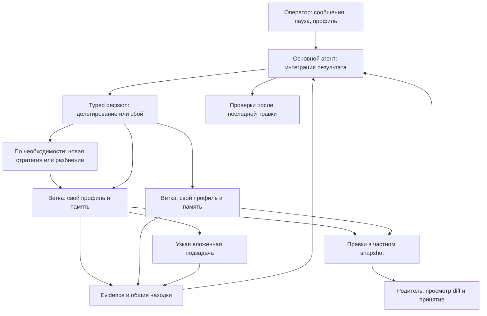
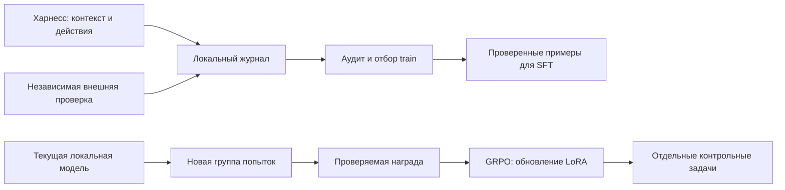

# Общий движок, когнитивные профили и экономия

`src/harness.Harness` и совместимый `src/coding.CodingHarness` — один цикл для разработки,
математики и алгоритмов: план → действие → свидетельство → проверка → пересмотр.
Доступен через `sea solve` / `sea code` и desktop `task_mode=coding` (**Движок · Авто**).
Прежний LangGraph-граф сохраняется отдельно. Это реализованный рантайм и небольшие
измерения, а не подтверждённое универсальное качество малой модели. Исследования,
целевая архитектура и недостающие механизмы: [универсальный движок](universal_harness_design.md).

Доводка результата: замечания критика привязаны к требованиям и сохраняют конкретный
следующий шаг, режим и способ проверки. Именованные выходные файлы проверяются в рабочем
проекте; `inspect_artifact` читает формат и содержимое PDF/PPTX/JSON. `ask_user` сохраняет
настоящие вопросы без подстановки ответа за человека. Подробности, источники DSH Superagent
и ограничения: [адаптация механизмов доводки](dsh_superagent_adoption.md).

## Текущий профиль: дешёвое облако

По просьбе пользователя локальный llama-server остановлен; модельные запросы идут в облако.
В `config.yml` явно выбран `coding.backend: openrouter`, модель
`google/gemini-3.1-flash-lite`. Выбор существующего режима делает Jev 1.13 через typed
Decisions API; Gemini составляет новую стратегию или разбиение только по запросу контроллера.
Не происходит переключения на более дорогую модель или запуска локальной модели.

Перед запросами адаптер проверяет тариф в каталоге: максимум $0.30/M входа и $2.00/M
выхода. Провайдеру также передаются эти ценовые ограничения. Расход исполнителя ограничен
конвертом $0.10 за запуск; выбор режима — $0.001 и четыре вызова, условный планировщик —
$0.004 и два вызова, критик — $0.02
и восемью вызовами, включая извлечение требований. Итоговый учёт включает все роли. На параллельные
запросы заранее резервируется общий бюджет. Если поток отменён и точный биллинг недоступен,
учитывается консервативная оценка; UI не выдаёт её за точное списание. Это клиентские
предохранители, не ограничение всего аккаунта OpenRouter. `resume` начинает новый запуск
и новый конверт. При недоступном API работа сохраняется; дорогого fallback нет.

```sh
uv sync --group dev
# Ключ уже настроен; ввод нового ключа: uv run sea key
uv run sea code --root /path/to/project --auto "Реализуй изменение и проверь"
uv run sea code --root /path/to/project --plan "Спроектируй изменение"
uv run sea code --root /path/to/project --resume
```

`sea solve --same-model` использует выбранный backbone для всех модельных ролей, включая
контроллер и критика: отдельные OpenRouter-адаптеры для них не создаются. Это нужно для
честного эксперимента с ≤10B и полностью локального исполнения.

Без `--auto` правки и команды требуют подтверждения. `--plan` запрещает их независимо
от выбранного типа мышления. В desktop окно **Движок · Авто** выбирает глубину
рассуждения, проект и исполнение. Low / medium / high меняют запрос к провайдеру согласно
метаданным модели; реальный объём thinking зависит от неё. Для optional reasoning low
запрашивает отключение, для mandatory reasoning отключение не обещается. Явно заданный
`coding.max_output_tokens` не уменьшается при low; общий потолок адаптера — 8192 токена.

## Профиль — инструкции и инструменты, память — состояние работы

Доступны inspect, reason, plan, research, review, repair, implement, verify. Это профили
системных инструкций и инструментов, а не новые модели. При переключении сохраняются id
ветки, задача, рабочая сводка, план, наблюдения, прочитанные фрагменты и ссылки на evidence.
Старый незавершённый ответ отменяется и не может выполнить действие после переключения.

Динамический промпт собирается из базовой политики, профиля и выбранных правил: воспроизвести
ошибку, минимальная правка, сравнить гипотезы, официальные источники, граничные случаи,
остановить повторение. Генеративный планировщик может создать ограниченный профиль: base, strategy,
tools, exit_when, reasoning. Стратегия применяется как инструкции, но не изменяет базовую
политику, ограничения человека и неизменяемый потолок инструментов данной ветки.

Сабагент получает отдельную рабочую память и обязательную передачу состояния от родителя:
общую цель, подзадачу, сводку, план, evidence и текущие сообщения оператора. Полная история
родителя и частные записи соседней ветки не копируются. Общие находки передаются отдельно
через evidence board. Сводки считаются заявлениями модели: проверяются наличие evidence
и актуальность файлов по SHA, но не объявляется доказанной истинность текста сводки.
Родитель и каждая ветка также видят до шести последних непосредственных подзадач:
id, статус, краткий результат, evidence и устаревшие относительно родителя файлы.
Эта сводка переживает вытеснение результата из окна последних действий. Незавершённую
ветку можно продолжить через `resume_agent`, не создавая копию той же работы.

`coding.orchestration.decision.backend: decisions` использует закрытый список доступных
профилей. Режимы записи исключаются в plan/read-only, исследование — без web/fetch.
Порог probability 0.5 и разрыв 0.1 являются эвристикой, не калиброванной гарантией:
при неоднозначности профиль и набор инструментов сохраняются. `compose` вызывает
генеративный планировщик только для нового профиля/независимых подзадач. Неизвестные
имена режимов отклоняются. Общий транспорт `decisions_api.py` проверяет идентификаторы,
распределения и тарифы; конкурентные запросы делят лимит и кеш. Отмена не обнуляет расходы.
`same_model` исключает и decision API, и отдельный планировщик.



Ветки запускаются логически параллельно и могут делегировать рекурсивно. Физические запросы
ограничивает semaphore: по умолчанию один слот, чтобы локальный профиль не раздувал KV/RAM.
Число веток не зашито в конкретный тип мышления: действует общий настраиваемый бюджет
`max_nodes: 12` новых узлов на запуск, `max_depth: 3`, `max_branches: 3`, `mind_turns: 16`,
два корневых делегирования. При `isolated_writes: true` implement/repair-ветка получает
частный snapshot текущих исходников родителя. Изменения не видны родителю до просмотра
`patch` и принятия через `accept`. Зависимые предложения можно принять вместе через ids;
совпадающие несовместимые правки отклоняются. Проверки запускаются на составленном результате
до принятия; после принятия нужны проверки родителя. Исходные хеши защищают от устаревшей
правки; принятие имеет rollback. Это собственные snapshots, без git reset/commit/worktree.
Бинарные патчи не поддерживаются. В контейнерном benchmark-backend дочерние ветки пока read-only.

Автоматика меняет профиль по фазе, повторным ошибкам и отсутствию прогресса; модель роутера
может предложить другой профиль, ветвление или паузу. Операторский выбор приоритетнее
автоматики до выбора auto. Обычное успешное исполнение обходится без запросов роутера.
Событийный observer следит за всеми активными ветками и обращается к модели только при
конкретной аномалии. Отдельный критик сверяет попытку завершения с acceptance contract,
извлечённым из исходной задачи и сообщений человека. Мнение критика не является доказательством.

## Живой оператор и дозапросы

Пока идёт разработка, обычное сообщение в чате становится steering. Панель **Оператор**
показывает дерево, сводки, инструменты, действия, фактически переданный контекст и receipts,
а также reasoning, если провайдер его возвращает. Наблюдение событий не вызывает LLM.
Reasoning — доступный текст провайдера, не доказательство того, как модель приняла решение.

- `POST /run/{id}/steer`: message, target, interrupt; action steer / pause / switch, mode.
- `GET /run/{id}/context`: текущие агенты, сводки, evidence, реальный контекст запросов.
- `POST /run/{id}/cancel`: остановка с сохранением checkpoint.

Инструкции оператора сохраняются в журнале и действуют на адресованное поддерево. Они не
обрезаются до последних нескольких сообщений: если обязательные ограничения не помещаются
в контекст, запрос останавливается с объяснением. Профиль, права и глубина reasoning —
отдельные настройки. Переключение профиля не повышает права ОС.

## Инструменты агента и проектный контекст

`diff`, `grep`, `status`, `tree`, `read`, `search`, `edit`, `write`, `run`, `check`, `evidence`
доступны самой модели. Read возвращает точный исходный текст с диапазоном и признаком EOF;
номера строк не загрязняют текст для exact edit. Diff отключает внешние diff/textconv.
Проверки обнаруживаются по Python/Node/Rust/Go/CMake-манифестам; свои задаются в coding.checks.

```yaml
coding:
  checks:
    unit: [.venv/bin/python, -m, pytest, -q, tests/unit]
    frontend: [npm, --prefix, frontend, run, build]
```

Только зарегистрированный check или полностью совпадающий argv устанавливает проверку.
После изменения проверка теряет актуальность. Известный провал должен быть исправлен;
ошибочное имя check не становится вечной неразрешимой «упавшей проверкой». Если проверок
нет, агент получает возможность создать/зарегистрировать подходящую проверку через
`register_check`; без текущего успешного check завершение после правок не принимается.
Проверки выполняются в одноразовом writable snapshot, чтобы тесты могли создавать файлы,
не повреждая проект. Пакет для критика ограничен; это пока не полноценный активный verifier.

`math` использует SymPy через ограниченный AST-интерпретатор без eval: точные дроби,
производные, интегралы, суммы, тождества, явные предпосылки. `experiment` запускает
Python/C++ в scratch с timeout. Конечный эксперимент не считается общим доказательством.
Для чистой математической/алгоритмической задачи контракт выбирает профиль без записи
в исходники проекта. Формальный Lean/SMT-backend пока отсутствует.
Явно запрошенный JSON-ответ и обязательные верхние ключи проверяются механически перед
модельным ревью. Это проверка формы доставки, не истинности остальных полей.

### Требования, активная проверка и выбор контекста

Контракт задачи превращается в `obligations-<agent>.json`: требования, предложенные
утверждения, зависимости и ID свидетельств. Инструмент `claim` записывает утверждение
с предпосылками и файлами; циклы и неизвестные ссылки отклоняются. Обновление зависимости,
файла, evidence или операторского ограничения инвалидирует прежнюю поддержку. Статус
`supported` означает модельное ревью с указанными свидетельствами, не формальное доказательство.
Панель оператора показывает требования и статус поддержки.

`coding.orchestration.critic.active: true` включает короткий план независимой проверки
и до двух наблюдений: read/search/evidence/math либо Python-probe в одноразовой копии
текущих исходников. Таймаут исполнения 15 секунд, сеть закрыта, исходный проект не меняется.
Критик получает код пробы и проверяет также её ожидаемые значения. Неадресованное падение
пробы блокирует завершение. Ошибка импорта/тестового оракула не объявляется ошибкой продукта.
Успешные наблюдения переиспользуются при исправлении только ответа; старый candidate ID
передаётся явно, новое заключение требует отдельного ревью. Изменение исходников/задачи
сбрасывает этот кеш. План проб и ревью расходуют общий лимит вызовов и денег критика.

Навигатор контекста хранит альтернативные группы и курсор каждого агента.
`context {action:"next"}`, `back`, `reset` и `query` — инструменты самого агента,
не команды пользовательского CLI. По умолчанию `coding.navigation.backend: decisions`
использует `typesafe/jev-1.13`; для Liquid достаточно заменить `model` на `liquid/d1-ultra`.
Обе модели вызываются через один OpenRouter Decisions API, локальное inference не нужно.
Стоимость проверяется по конкретным `/models/{author}/{slug}/endpoints`, потому что
общий список `/models` может не содержать decision-модели. Раньше именно эта проверка
ошибочно блокировала подключение. Совместимое имя backend `jev` также поддерживается.
Лимит — два запроса и $0.002 на запуск, повторы кешируются;
при недоступной модели/цене/ошибке остаётся локальное ранжирование с явной причиной.
Для полностью бесплатного отбора можно установить `backend: lexical`.
`--same-model` запрещает скрытый отдельный scorer.

Живой `scripts/decision_scenario.py --live`: по четыре коротких искусственных набора
для каждой модели, правильный источник на первом месте во всех восьми случаях;
повторный запрос брался из кеша без обращения к API. Jev — $0.000093702, Liquid —
$0.000047250. Это интеграционные проверки ранжирования, не бенчмарк и не основание
считать более высокие числовые confidence одной модели лучшим качеством.
Результат: `data/eval/decision-models-scenario.json`.

Дополнительное сравнение контроллеров (`scripts/controller_comparison.py --live`):
на восьми фиксированных состояниях Qwen 9B выбрал ожидаемый режим в 7/8, Jev — в 6/8
(два неоднозначных решения сохранены без переключения). Суммарное время вызовов —
12.752 s против 3.600 s, стоимость — $0.00114972 против $0.000304752. Токенов у Jev
больше: 8079 против 6084. Это экономия денег и задержки на данном наборе, не доказательство
лучшего качества или меньшего числа токенов. Предыдущий прогон выявил придуманные режимы
`direct`/`read`; их теперь запрещает контракт. Оба отчёта сохранены.

`scripts/harness_ablation.py --live` сравнивает passive/active/hybrid на одинаковой облачной
Qwen 3.5 9B: код, точная сумма, coin-change. Контроллер, критик, дочерние ветки и отменённые
запросы входят в учёт. Варианты имеют одинаковый денежный конверт $0.025, общий порог
60k токенов и таймаут 120 s; порог токенов проверяется между вызовами и может быть превышен
последним ответом. Проверочный код недоступен агенту и запускается после него в snapshot.
В первой полной серии ни один из девяти запусков не удовлетворил всем проверкам: повторы,
ошибки контрактов и формата ответа. Это сохранено в `data/eval/harness-ablation-v2.json`.

По этим сбоям добавлены сводка подзадач, обязательные поля domain/формата в wire-схеме
контракта и одна попытка исправить невалидную схему в общем бюджете. После правок алгоритм
прошёл независимую проверку за $0.00260205; математический контракт всё ещё выдавал
невалидный enum даже после повтора ($0.00031391). Включение medium reasoning не спасло
задачу разработки до порога токенов ($0.010224064). Это диагностические повторные прогоны,
не сравнение на новом отложенном наборе и не подтверждение качества флагмана у 9B.
Отчёты: `harness-ablation-contract-fix.json`, `harness-ablation-medium.json` в `data/eval/`.

Проверка интеграции от 30 октября 2026, Gemini 3.1 Flash Lite, reasoning low:

| Сценарий | Результат | Цена |
|---|---|---|
| Критик: неверный greedy, затем корректный DP | Неверное решение отклонено, верное принято; исходники не изменились | $0.00366275 за обе проверки |
| Единый движок: точная рациональная сумма | done, ответ совпал с независимым Fraction-checker, 12.25 s | $0.00750525 |
| Единый движок: минимальный контрпример greedy и описание DP | done, численный ответ совпал с независимой проверкой, 9.15 s | $0.00468250 |

В двух задачах движка все модельные роли использовали один backbone. Формальные доказательства
checker не проверяет. Это небольшие интеграционные случаи, не результат SWE-bench/Terminal-Bench
и не доказательство универсальности ≤10B. Предыдущие неуспешные прогоны сохранены отдельно:
они обнаружили ложные требования, неверные ссылки и ошибочный тестовый оракул. Расход всех
облачных итераций этой доработки — $0.07191075, успешной заключительной серии — $0.01585050.
Воспроизведение: `scripts/verification_scenario.py --live` и `scripts/universal_scenario.py --live`.
Отчёты: `data/eval/active-verifier-control-v3.json`, `data/eval/universal-scenario-v6.json`.

`web` / `fetch` ищут инструкции для незнакомой техники без отдельного LLM-исследователя.
Поиск — только общие термины; результаты считаются недоверенными. Повторные запросы кешируются
в рамках запуска. `learn` создаёт кандидата урока; только после успешных проверок он становится
историческим few-shot в проектной библиотеке. Примеры привязаны к стеку, дедуплицируются,
подбираются локально; receipt показывает, что реально попало в запрос.

`project_note` поддерживает fact, hypothesis, decision, procedure, pitfall, question, preference,
reference. Локальный индекс `.sea/context/INDEX.md` ведёт к отдельным заметкам. Факты привязаны
к evidence и хешам исходников; неизвестное сохраняется как вопрос/гипотеза. Preference требует
ссылки на явное сообщение человека, а не вывода о его личности. Есть краткие рабочие правила
для Python, C++/CMake, Linux-команд и Docker. Это подсказки, не гарантия компетентности модели.

Команды на macOS исполняются через sandbox-exec, на Linux — bubblewrap; без доступного
sandbox нет молчаливого запуска с полными правами. Исходники доступны на чтение, сборки и
кеши пишутся в `$SEA_SCRATCH`; секретные пути и метаданные агента закрыты, окружение очищено.
Дополнительная сеть или запись командой в проект требует отдельного подтверждения даже
в auto. Доступ к Docker socket не является обычным безопасным чтением. macOS проверена
реальными subprocess-тестами, включая C++ компиляцию; Linux-монтирования требуют отдельного
нативного интеграционного прогона. Граница не заменяет отдельную VM для враждебного кода.

Checkpoint, журналы и сводки находятся в `.sea/coding/<session-hash>/`. Запись атомарна;
межпроцессный lock не допускает двух авторов в одном проекте. Resume сохраняет задачу,
план, заметки, профили, дерево и предложения дочерних веток, но заново требует проверок.
`resume_agent` позволяет продолжить незавершённую прямую дочернюю ветку с её памятью.
Принятые старые snapshots не используются для новой работы на изменившемся родителе.

## Что взято из Harness² и DeepSeek Harness

Изучены исходники и документация на указанных ревизиях; сторонний код не переносился.

| Источник | Сильное решение | Применение и предел |
|---|---|---|
| [Harness², 1cfe254](https://github.com/google-research/harness2/tree/1cfe254e8d25b15f37048c3730134686abe60335) | Propose–Probe–Compose, журналы evidence, повторное использование проверенных решений, бюджет | Проверки исполнения и проектные примеры; дорогое исследование кандидатов не запускается на каждый запрос. Собственная реализация не наследует результаты их benchmark |
| [DeepSeek Harness, f3803c9](https://github.com/deepseek-ai/deepseek-harness/tree/f3803c96974ad4a94195fb97e5c637e9c2a3afe3) | Разделение agent loop / tools / context / policy, события и изолированные сабагенты | Отдельные адаптеры и state machine, управляемые профили, observer; Cordis/TypeScript-платформа не копировалась |
| SEA до изменений | Память, рецепты, много интеграций | Сохранены в универсальном графе. Проблемы: много LLM-стадий, большой модуль, embedding-зависимости на важных границах, устаревшие архитектурные утверждения |

Дополнительно исправлены загрузка config/skills вне cwd, доверие при недоступном embedding-
классификаторе, повторные ошибки авторизации эмбеддера и учёт researcher в tracing/backward.
Оффлайн-тесты блокируют сеть; семантические live-проверки явно opt-in.

## Локальный запасной профиль: Unsloth GGUF

Ollama не требуется. Уже скачаны и проверены по SHA256 Unsloth Qwen3.5 4B Q4_K_XL,
9B Q2_K_XL и 9B Q4_K_XL в gitignored `data/models/unsloth/`. Файлы занимают соответственно
2.91 / 4.12 / 5.97 GB. Названия квантов обозначают смешанную точность, не точное число
бит на каждый вес. Проверяются n_params из llama.cpp, лимит ≤10B относится к локальным
адаптерам. Облачная модель не выдаётся за модель ≤10B.

Когда локальная нагрузка снова допустима, два терминала:

```sh
# macOS, установлен llama.cpp с Metal; эта команда запускает локальную нагрузку
python scripts/serve_gguf.py --model-file data/models/unsloth/Qwen3.5-4B-UD-Q4_K_XL.gguf
uv run sea code --backend llama_cpp --base-url http://127.0.0.1:8081/v1 --model sea-local \
  --root /path/to/project --auto "Исправь ошибку и проверь"
```

Для полностью локального исполнения используйте `--same-model`, иначе настроенные отдельно
decision и critic могут оставаться облачными. Cloud-контур и локальные модели не стартуют
друг друга автоматически.

Локальный cache_prompt переиспользует точный префикс запроса в слоте llama.cpp. Это не
семантическая общая память и не перенос KV между разными моделями. Через OpenRouter физическим
KV управляет провайдер; приложение видит только сообщённые cache usage. Совместный контекст
подшагов реализован сводками/evidence, а не фиктивным «общим KV-cache».

## Измерения и ограничения

### Протокол, endpoint и воспроизводимость

По умолчанию `coding.action_protocol: json`. `sea solve --action-protocol tools` включает
экспериментальный нативный function calling только для OpenRouter. Состав функций берётся из
того же ограниченного набора действий; runtime-проверки не обходятся. До двух реальных коротких
наблюдений передаются как assistant/tool messages, дополнительно к текущему состоянию.
Контракты и семантический критик продолжают использовать структурированный JSON.

`coding.provider_only: ["provider/endpoint"]` фиксирует конкретный endpoint и отключает fallback.
Точный slug нужно брать из каталога OpenRouter. Одно имя Qwen 9B обслуживалось разными
провайдерами с FP4, FP8 и BF16; сравнивать их как неизменную модель некорректно.
В usage пишется фактический provider. `strict_schema` включён по умолчанию, а bounded schema
hint поясняет обязательные ключи и enum модели. Поддержка параметра провайдером не гарантирует
поддержку каждого его значения: Darkbloom принимал `auto`, но отклонял `tool_choice=required`.
В нативном режиме клиент требует ровно один допустимый вызов даже при `tool_choice=auto`.

См. первичные источники: [structured outputs](https://openrouter.ai/docs/guides/features/structured-outputs),
[provider routing](https://openrouter.ai/docs/guides/routing/provider-selection),
[tool calling](https://openrouter.ai/docs/guides/features/tool-calling).

`scripts/harness_ablation.py` сохраняет hash исходников движка и заданий, модель, endpoint,
протокол, reasoning, лимит денег, статусы, фактический расход и независимую проверку.
`--suite diagnostic|transfer`, `--variant passive|active|hybrid`, `--budget-usd` позволяют
измерять зависимость результата от конфигурации и бюджета. Ответы независимой проверки
исполнителю не передаются. В математике/алгоритмах отдельно считаются наличие правильного
кандидата, финальное принятие и ложное принятие; текст доказательства формально не проверяется.
Инструменты считаются по всем ролям: наблюдение критика тоже является реальным исполнением.
Прежний счётчик только главной ветки ошибочно отмечал такие случаи как отсутствие инструмента.

```sh
# Без --live API не вызывается. Максимум $0.025 на один запуск по умолчанию.
uv run python scripts/harness_ablation.py --live --suite transfer \
  --variant hybrid --model google/gemini-3.1-flash-lite --protocol json
```

Серия разработки включала неудачи, и они сохранены в `data/eval/harness-*.json`:
повторение действий 9B, неверные аргументы математического инструмента, ложное требование
принять worker patch после read-only review, недостаточный бюджет на запрошенные тесты;
отдельно — HTTP 429, timeout и upstream inference errors провайдера. Исправления проверены
регрессионными тестами, но один успешный повтор не доказывает общий выигрыш.
`harness-frontier-gemini.json`: новая математика и алгоритмы прошли; software выдала рабочую
реализацию без полного выполнения требования о тестах. `harness-grounded-gemini.json`
сохраняет повтор software при прежнем лимите $0.025: независимая проверка кода прошла,
полное задание осталось незавершённым. Нативный transport не стал новым default по этим данным.

После исправлений контракта, ссылок на evidence и допустимости `finish` получены следующие
результаты на Gemini 3.1 Flash Lite + Jev controller, low, JSON:

| Сценарий | Полное завершение и независимая проверка | Расход | Время | Hash движка / отчёт |
|---|---|---|---|---|
| Разбиение списка: исправление, read-only reviewer, новые тесты, unit check | Да | $0.014786464 | 22.03 s | `fc2b25c14dbc`, `harness-action-gates-gemini.json` |
| Точная телескопическая сумма | Да; проверено значение, не формальное доказательство | $0.006732 | 10.16 s | `9bd36936e41b`, `harness-final-transfer.json` |
| Максимальное совместимое подмножество интервалов | Да; оптимум проверен перебором | $0.00332975 | 5.50 s | `9bd36936e41b`, `harness-final-transfer.json` |

Общий лимит каждого из этих запусков — $0.05, включая отдельно ограниченные controller/planner;
это лимит, не фактический счёт. Последние два результата предшествуют исправлению finish/evidence,
поэтому таблица **не является одним запуском трёх задач на единой финальной версии**.
На той предыдущей версии software остановилась по порогу 60k токенов после добавления тестов,
но до повторной проверки; неудача сохранена в том же отчёте. После первого использования эти
сценарии стали диагностическими примерами разработки, а не нетронутым отложенным набором.

Qwen 9B по-прежнему не получила подтверждённого устойчивого результата в этой серии.
Помимо повторов действий, были ошибки генерации Darkbloom FP4. Контрольная попытка на Parasail
BF16 с medium reasoning остановилась по 120-секундному timeout; это не доказательство
неспособности 9B решить задачу. Отчёт: `harness-qwen-bf16-reasoning.json`.
Суммарный учтённый расход этой итерации разработки — около $0.254, включая отрицательные
попытки и консервативные резервы для оборванных потоков; это не точная выписка биллинга.
Локальная модель в этой итерации не запускалась.

Два маленьких сценария `scripts/coding_eval.py`: исправление average и добавление parse_port.
После работы модели исходные тесты восстанавливаются, затем результат проверяется независимо.
Это smoke разработки, не Terminal-Bench и не статистический рейтинг моделей.

| Проверка | Результат |
|---|---|
| Дешёвое облако, low, версия harness `536197e512aaceb9` | 2/2 done + независимые тесты; 10.04 / 14.29 s; 8 / 12 вызовов; $0.00506 / $0.00851; 43 075 входных + 1 870 выходных токенов суммарно |
| Живое ветвление и переключение, `cognitive_smoke.py` | Две отдельные ветки, live switch с тем же объектом памяти; одна закончила, другая честно partial. Бюджет учёта $0.0090 worker (оценка из-за отмены) + $0.000465 routing |
| Ранний Unsloth 4B Q4 smoke | 2/2; около 50 tok/s, пик RSS около 4.35 GiB |
| Ранний Unsloth 9B Q4 smoke | 2/2; около 35 tok/s |
| 9B Q2 и более тяжёлый вариант harness | Нестабильное исполнение; больше планов/повторов. Не принят как подтверждённо лучший профиль |

Эти локальные и облачные прогоны сделаны на разных промежуточных версиях; прямое сравнение
качества квантов или моделей по таблице некорректно. У более насыщенного harness был и
регресс: одна простая задача заняла 295 s и осталась незавершённой. Добавление наблюдателей,
веток и thinking не является само по себе улучшением; поэтому они ограничены и выборочны.

Многофайловый `development_scenario.py`: два исполнителя действительно меняют разные модули
в своих snapshots и добавляют тесты; родитель принимает оба предложения. Независимые проверки
gzip/CSV/Unicode/атомарной записи прошли. Первый этап сохранил незавершённую проверку контракта;
resume корректно восстановил предложения и завершился. Вместе около $0.05985. Это интеграция,
не benchmark. Более ранний вариант выявил ложную готовность без запрошенных новых тестов;
после этого добавлены независимый acceptance contract и механические проверки обязательств.

`universal_scenario.py` проверил два случая через тот же engine и одну облачную модель во всех
ролях: точная рациональная сумма и контрпример для greedy coin change. Финальные независимые
проверки значений/формата и использования инструментов прошли 2/2, $0.00725175, 8.49/6.24 s.
Неформальные объяснения корректности и сложности автоматически не доказаны. В предыдущей
версии оба значения были верны, но ответ не соблюдал JSON; это был отдельный сбой доставки.

В официальном Terminal-Bench@2.0 одна выбранная сложная задача `cancel-async-tasks` получила
внешний reward=1 с `deepseek/deepseek-v4-flash`, стоимость $0.0153432, 291 s. Собственный
harness остановился как paused; внешняя оценка относится к артефакту. Gemini Flash Lite и
Qwen3.5-9B на этом случае получили reward=0. Это **не процент решения всего Terminal-Bench**
и не подтверждение высокого качества 9B. Версии адаптера между попытками менялись.

SWE-bench Verified добавлен через тот же Harbor-адаптер; скачаны 500 задач. Первый фиксированный
случай `astropy__astropy-12907` не дошёл до модели: образ x86_64 не запускался нативно на ARM;
попытка с linux/amd64 остановилась по шестиминутному timeout запуска среды. Это инфраструктурная
ошибка, **не решённая задача и не нулевой балл модели**. Валидной SWE-оценки пока нет.
Benchmark-решения и hidden tests модели не передавались, обучение на benchmark выключено.

Полные локальные результаты: `data/eval/cheap-cloud-v4.jsonl`, `cognitive-cloud.json`,
`unsloth-4b-final.jsonl`, `unsloth-9b-q4.jsonl`, `harbor-q4-smoke/`. Это gitignored runtime-data.

## Проверка качества общего ядра, 30–31 октября 2026

`scripts/quality_ladder.py` проверяет математику, алгоритмы и исправление Python/C++/SQLite.
Семь первоначальных семейств параметризуются seed. Дополнительно добавлены вероятность
связности сети, назначение с запретами и сохранение атомарности SQLite в транзакции вызывающего.
Параметрические варианты прежнего семейства не считаются новыми независимыми семействами.
Эталонные ответы/программы остаются у внешнего оценщика. Успех требует одновременно правильного
артефакта/ответа, выполнения явных процессных требований и `status=done`. Текст доказательств
не проверяется формальным ядром.

Все роли внутри этих сравнений используют одну модель. Gemini закреплена за `google-ai-studio`,
Qwen3.5-9B первоначально — за `deepinfra/bf16`; локальный inference не запускался. Отчёты содержат цену, токены,
endpoint, конфигурацию и контрольные суммы. Новые серии сохраняют архив полного Python-исходника,
`uv.lock` и проверяют, что исходники не менялись во время прогона.

| Прогон | Успех | Ложное завершение | Учтённая стоимость |
|---|---:|---:|---:|
| Исходный Gemini, seed 101 | 5/7 | 2 | $0.062955 |
| Привязка ответа v1, seed 101 | 2/7 | 0 | $0.051847 |
| Привязка v2, два выбранных случая | 1/2 | 1 | $0.017134 |
| Привязка + adaptive tools, seed 101 | 3/7 | 1 | $0.118636 |
| Привязка v3, seed 101 | 6/7 | 0 | $0.081494 |
| Привязка v4, seed 101 | 3/7 | 0 | $0.105741 |
| Привязка v5, seed 101 | 6/7 | 0 | $0.095537 |
| Контроль v6, 10 случаев, seed 407 | 7/10 | 0 | $0.151681 |
| Привязка v6, те же 10 случаев | 7/10 | 0 | $0.101217 |
| Qwen3.5-9B v6, три разных области | 0/3 | 0 | $0.017802 |
| Интерфейс сертификатов, три случая | 1/3 | 0 | $0.017087 |
| Последний ремонт, два проблемных случая | 1/2 | 0 | $0.030852 |

Это журнал разработки с отрицательными результатами, **не доказательство статистического
выигрыша** и не SWE-bench/Terminal-Bench score. В сравнении v6 контроль получил два HTTP 402,
новая версия — HTTP 400 при подготовке одного задания. Поэтому разницу стоимости нельзя
объявлять чистым эффектом оптимизации. После исправления слишком большой схемы и выдуманного
JSON-формата SQLite-код прошёл независимые проверки и собственные тесты, но runtime корректно
оставил `paused`: проверяющий исчерпал лимит после ошибки в своей проверке транзакции.

9B: условное ожидание остановилось на повторяющемся обрезанном JSON; назначение — по таймауту
300 секунд после вложенной делегации; SQLite — по лимиту токенов с непрошедшим независимым
тестом. Высокое универсальное качество ≤10B этими опытами **не достигнуто**.

Сумма всех сохранённых `quality-*.json` прогонов этой итерации — **$0.85927291**; ещё $0.00008725
составил тест формата ответа и $0.0054493 — консервативная резервная оценка отклонённого запроса.
Это учёт harness, включающий оценки для отменённых/отклонённых запросов, а не банковская выписка.
Агрегат этой серии: `data/eval/quality-iteration-summary.json`. Офлайн-регрессия на её завершении:
**759 passed, 3 skipped**. Она проверяет инфраструктуру, не интеллект модели.

Продолжение 31 октября: ограниченный ремонт software-проверяющего позволил полностью завершить
SQLite-задачу на Gemini — независимые проверки, добавленные тесты и `status=done`, 26.17 s,
$0.01707. Сохранились исходная ошибка checker, успешная замена и явное решение ревью о том,
почему ошибка относилась к checker. Отчёт: `quality-probe-repair-gemini-407.json`.

Для 9B сокращение схемы планирования устранило наблюдавшиеся обрезанные JSON-планы, но первый
прогон по-прежнему остановился через 240 s после лишней делегации и ошибок вызова математики.
Добавлены порог наблюдений перед корневой делегацией и конкретная подсказка функций math.
Два следующих запроса DeepInfra вернули HTTP 429 до генерации — это ошибки доступности,
не результаты решения задач. После явного переключения на `parasail/bf16` 9B получила правильный
математический кандидат и исправила LRU-код. **Оба процесса остались незавершёнными**:
неверное обращение к API проверяющего и отсутствие требуемых новых тестов соответственно.
Стоимость двух задач $0.0141339, время 76.46/71.66 s; перенос endpoint не позволяет приписать
разницу одному изменению harness. Отчёт: `quality-evidence-gate-parasail-407.json`.

Чтобы уменьшить ошибки аргументов, новый oracle получает простой интерфейс Python-словарей
`EXPECTED`/`VALIDATORS`; прежние функции сохраняют совместимость. После этих изменений полная
регрессия: **767 passed, 3 skipped**. Высокое универсальное качество малой модели ещё не подтверждено.

Live-проверка нового интерфейса на той же задаче 9B также осталась `paused`: правильный кандидат
был получен, но checker печатал вычисления без обязательного экспорта, а попытки восстановления
исчерпали бюджет проверок (100.15 s, $0.0078449, 65339 токенов). Интерфейс поддержан и протестирован,
но его преимущество по качеству этим прогоном **не подтверждено**. Все исходники были заморожены
на время измерения. Отчёт: `quality-export-maps-qwen-407.json`.

Сводка этого продолжения: `data/eval/quality-probe-repair-summary.json`, учтённая стоимость
**$0.04897688**, включая оценки отменённых/отклонённых запросов. Это отдельная сумма сверх
предыдущей серии, без локального запуска LLM.

Следующая итерация заменила инструкцию «не забудь экспортировать» обязательной схемой
`{code, outputs, limitation}`. Поле `outputs` должно содержать все вычисляемые ключи и имена
вычисленных переменных/функций. Runtime связывает их с фактическим ответом; неверные значения,
пропущенные поля и подмена уже проверенного witness продолжают отвергаться.

На `primeintellect/bf16` та же Qwen3.5-9B полностью завершила `conditional_urn`, seed 407:
**done**, независимый ответ и процесс прошли, 25.96 s, $0.00420983, 23663 токена.
Проверяющий вычислил точную дробь и передал её через обязательное поле без ремонта экспорта.
Это один успешный случай, не оценка общего качества. Два предшествующих прогона Parasail
остановились на HTTP 429 после нескольких вызовов; endpoint изменён явно и записан в отчётах.

В LRU после конкретных подсказок требований агент уже добавил регрессионные тесты и вызывал
`check unit`, но написал неверные ожидания порядка/вытеснения. Независимая проверка реализации
прошла, собственные новые тесты — нет; полный успех не засчитан. Дополнительно исправлен
приоритет подсказки: неудачная проверка требует сначала диагностики реализации, нового теста
или среды, а не немедленного повторного запуска. Повторный live-прогон всё равно остановился
на повторяющихся планах. Эффективность этой подсказки для решения LRU пока не подтверждена.

На новом параметрическом варианте `negative_dag`, seed 909, в режиме low агент не дошёл до
кандидата: ошибался в собственном Python-расчёте, включая зацикленное восстановление пути.
Прогон остановился по денежному лимиту, 111.14 s, $0.01269991. Это не ошибка нового oracle:
до независимой проверки ответа выполнение не дошло. Новый seed не является новым семейством
задач или независимым публичным benchmark. Полная регрессия текущего кода: **770 passed, 3 skipped**.

В режиме medium на том же DAG при потолке $0.015 был получен независимо правильный кандидат,
но oracle ошибочно насчитал три кратчайших пути вместо одного. Runtime заблокировал завершение
на этом противоречии; последующая работа исчерпала денежный лимит (154.37 s, $0.01283539).
Это ложное отклонение правильного кандидата, не успешное решение. Между low и medium также
менялись подсказки диагностики тестов, поэтому это не чистая абляция только reasoning.
Следующий приоритет — разбирать противоречия кандидата и исполняемого oracle, сохраняя оба
наблюдения и требуя независимого разрешения, вместо предположения, что ошибка всегда у кандидата.

Сводка этой серии: `data/eval/quality-typed-outputs-summary.json`, учтённая стоимость
**$0.06018343** (включая резервные оценки отклонённых запросов). Исходники каждого прогона
были заморожены, версии и endpoint сохранены. Это отдельная сумма сверх двух предыдущих серий.

В следующей серии добавлены ограниченный альтернативный oracle при противоречии, обязательное
явное разрешение каждого провала и сохранение обеих программ. При двух отклонениях готовность
не может быть подтверждена текстовым голосованием. Повторное ревью заново связывает значения,
но не получает старые ответы и вердикты как актуальные свидетельства. Это исправило наблюдавшееся
подмешивание прежнего описания алгоритма к исправленному ответу.

Live-серия по-прежнему обнаружила существенные ограничения. DAG получал правильный кандидат,
но останавливался на ошибках импорта/экспорта oracle и бюджете. Повышение reasoning при ремонте
не дало подтверждённого выигрыша: повтор остановился по timeout 180 s. У задачи назначения
исправлена ошибочная развилка: смешанная метка `software` больше не отключает числовую проверку
в пустом workspace без проектных обязательств. Внешние числовые проверки прошли, `done`,
35.8 s и $0.00571294; однако **ручное ревью обнаружило неверное обоснование общей сложности**.
Оценка `O(n^3+n!)` не учитывает независимое число работ m; описание преобразований прямоугольной
матрицы также неполно. Поэтому полного успеха всей задачи нет. В отчёт добавлен отдельный
`manual_argument_review`; исходный числовой критерий не переписан задним числом.

На отдельных диагностических ответах проверялись неверное объяснение, корректный перебор
и корректный DP, отличный от метода oracle. Это известные контрольные примеры, не независимый
benchmark. Medium reasoning неоднократно расходовал 3500/7000 токенов вывода без JSON-вердикта.
Поэтому финальное ревью оставлено на low по умолчанию; более глубокое задаётся отдельно через
`critic.review_reasoning`. Компактная схема возвращает ID требований вместо повторения текста
и ограничивает длину issues. Последняя серия вернула все три вердикта, но **пропустила ошибочное
объяснение**. Повышение семантического качества не доказано.

Дополнительно закрыто противоречивое завершение: `ready=true` при перечисленных незакрытых
замечаниях больше не принимается. Точные пустые обозначения вроде `None` нормализуются;
содержательные замечания блокируют завершение. Последняя эта правка проверена офлайн,
не выдаётся за новый live-результат. Сводка серии: `data/eval/quality-oracle-dispute-summary.json`,
учтённая стоимость **$0.05846861**, включая резерв отменённого запроса; отдельная сумма сверх
предыдущих серий. Ограничение reasoning требует отдельного контроля: токены размышления могут
занять весь общий лимит вывода. [Документация OpenRouter](https://openrouter.ai/docs/guides/best-practices/reasoning-tokens).
Итоговая регрессия этой версии: **788 passed, 3 skipped**; это проверка рантайма, не оценка
интеллекта модели. Валидного широкого SWE-bench/Terminal-Bench результата по-прежнему нет.

Следующая итерация восстановления добавила отдельную диагностику повторного падения
registered check, сохранение частичного вывода команды при timeout и снимок Python-стека
перед остановкой зависшего эксперимента. Диагноз — ограниченная непроверенная гипотеза;
он не разрешает завершение и не заменяет успешные проверки. Резерв бюджета включает
извлечение контракта, если оно ещё не выполнено, и последующие probe/review.

Два прогона известной development-задачи `lru_cache`, seed 407, на той же
`qwen/qwen3.5-9b`, PrimeIntellect BF16, reasoning low, лимит $0.015/90 s:

| Версия | Время | Стоимость | Результат |
|---|---:|---:|---|
| Первичная диагностика | 34.60 s | $0.01152652 | Реализация прошла независимые тесты; собственный тест не прошёл. Диагноз отклонён валидатором, точная причина в той версии не сохранена. Остановка на повторении плана. |
| Ограничения диагноза в JSON-схеме | 29.10 s | $0.01234535 | Диагноз принят и обнаружил `dict.move_to_end`; окончательная реализация не прошла независимую проверку. Остановка по бюджету. |

Оба результата **неуспешны по полному контракту**, ложного завершения нет. Общая учтённая
стоимость **$0.02387187**; исходники за время обоих запусков не менялись. Это не подтверждение
роста качества: один диагностический вызов может быть израсходован на предыдущую другую
ошибку, после которой агент вновь повторяет проверки/планы. Сводка и ссылки на исходные
трассы: `data/eval/quality-failure-recovery-summary.json`. Последняя полная офлайн-регрессия:
**797 passed, 3 skipped** (`/private/tmp/sea-recovery-final-tests.log`).

Следующая серия добавила постоянное свидетельство текущей ошибки, свежий контекст после
редактирования и удаление устаревших диагнозов. Полный повтор LRU seed 407 всё ещё неуспешен:
29.06 s, 71,111 tokens, **$0.01228383**; реализация прошла независимые проверки, собственный
новый тест остался неправильным. Это не подтверждает роста end-to-end качества.

Затем на сохранённом сбое проверен `scripts/failure_replay.py`: та же 9B составляет
исполняемую диагностику и получает максимум два действия исправления. Это **replay**, которому
уже переданы реализация и добавленные тесты; результаты нельзя считать решением с нуля.
Диагностическая программа правильно вывела порядок и возвращаемые значения LRU. Однако
исполнитель сделал эквивалентную замену `dict.get` и не исправил неверное ожидание теста.
В варианте с предварительным диагнозом: 7.52 s, 6,328 tokens, **$0.00113424**, проверки replay
не пройдены. В варианте без предварительного мнения: 4.38 s, 4,078 tokens, **$0.00072942**;
после первого бесполезного изменения следующий вызов остановлен резервированием бюджета.
Независимая проверка во втором replay не выполнена — её результат неизвестен.

Отдельный узкий аудит тем же 9B с reasoning medium: 15.52 s, 917 входных и 2500 выходных
токенов, **$0.00078089**, пустой JSON-ответ. Он не определил компонент ошибки. Сравнение
с предыдущими вызовами не отделяет эффект reasoning от смены роли и контекста. На основании
этого и предыдущих усечений добавлена отдельная обработка `OutputBudgetExceeded`; эта последняя
изменённая обработка проверена офлайн, а не новым платным прогоном.

Итого серия: **$0.01492838**, без нового полного успеха задачи. Сводка:
`data/eval/quality-current-failure-summary.json`. Финальная полная регрессия рантайма:
**817 passed, 3 skipped** (`/private/tmp/sea-output-budget-final-tests.log`). Эти числа не являются
баллом модели на задачах разработки. Основные открытые вопросы: правильная интерпретация
вычисленных свидетельств слабой моделью и управляемое получение финального ответа после reasoning.

Следующая итерация исправила скрытое снижение явного лимита вывода до 1536 при low.
Экспериментальный `coding.output_recovery: true` допускает один дополнительный вызов той же
модели и провайдера: получить завершённое действие из реально возвращённого незаконченного
черновика. Контекст задачи и ограничения сохраняются, черновик помечается непроверенным,
обрезанный tool call не исполняется. Дополнительный вызов входит в тот же денежный конверт,
его вывод по умолчанию ограничен 1536 токенами. Это выключено по умолчанию, не применяется
к критику или mandatory reasoning и пока проверено только офлайн.

Два реальных запуска бесплатной `liquid/lfm-2.5-2.6b:free` через `liquid/fp8` не дошли до
решения: LRU остановлен HTTP 429 до первого завершённого запроса; conditional urn получил
контракт требований, после чего следующий запрос вернул 429. Второй запуск: 7.57 s,
4929 токенов, включая 4208 выходных (3543 reasoning); учтённая стоимость обоих — $0.
Это **сбои доступности сервиса, не оценка способности модели решить задачи**. Отчёты:
`data/eval/quality-liquid-free-lru-407.json`, `data/eval/quality-liquid-free-urn-1013.json`.

После этих запусков добавлен `coding.min_request_interval_seconds` (по умолчанию 0, максимум
30): конкурентные запросы одного адаптера выдерживают заданный интервал между стартами.
Ожидание отменяемо, до отправки запроса резерв расходов не создаётся; после ожидания бюджет
проверяется заново. Это не автоматический retry и не гарантия устранения HTTP 429.
Контракт сохраняется в каталоге сессии и повторно используется при resume только при
совпадении задачи, указаний оператора, типа/имени модели, провайдера, настройки проверки
ответа и кода извлечения. Загруженный контракт повторно проверяется на привязку к тексту
задачи. Это экономит повторное извлечение; правильность решения по-прежнему проверяется
отдельно. Старый контракт без этих данных не мигрируется автоматически.

Runner `scripts/quality_ladder.py` поддерживает `--free-only` (нулевые тарифы и запрет
платного fallback), `--max-output-tokens`, `--request-interval` и экспериментальный
`--output-recovery`. Без `--live` запросов нет. Последние изменения интервала и resume
ещё не проверены реальным облачным решением; широкого SWE/Terminal результата нет.
Полная офлайн-регрессия после этих изменений: **855 passed, 3 skipped** за 32.77 s.
Сводка со ссылками на оба реальных запуска и версиями исходников:
`data/eval/quality-provider-recovery-summary.json`. Число тестов характеризует рантайм,
а не качество решений слабой модели.

### Диагностика через исполнение спецификации, 31 октября

Для повторного сбоя зарегистрированного Python unittest диагност получает трассу **самого
упавшего теста** до своего ответа: аргументы вызовов, возвращаемые значения и ограниченные
снимки состояния. Модель больше не обязана вручную воспроизводить последовательность
операций; в предыдущем эксперименте она пропустила ключевую мутацию. Это один дополнительный
ограниченный subprocess в копии проекта, без дополнительного LLM-вызова. Трасса не делает
ожидания теста правильными и не заменяет registered check. Неоднозначный test ID, отсутствующий
модуль или другой runner сохраняют прежний путь диагностики. pytest/C++ этим адаптером
не трассируются. Основа — стандартные [unittest](https://docs.python.org/3/library/unittest.html)
и [sys.settrace](https://docs.python.org/3/library/sys.html#sys.settrace).

Дальнейшие эксперименты на уже известном сбое LRU seed 407:

| Вариант | Модель | Токены | Стоимость | Результат ремонта |
|---|---|---:|---:|---|
| Точная трасса перед диагнозом | Liquid 2.6B free | 10 615 | $0 | 8192 токена вывода исчерпаны, структурированного диагноза нет |
| Слепое предсказание значений → свободная правка | Qwen 9B | 1485 | $0.00028285 | Предсказания для выполненных чтений правильные, правка неправильная |
| Повтор правки с явными аргументами | Qwen 9B | 726 | $0.00014446 | Модель предложила оставить ошибочный тест как есть |
| Компактные операции → механическая привязка | Qwen 9B | 344 | $0.00005952 | Неверные значения отклонены, правка не применена |
| Код теста со скрытыми ожиданиями → привязка | Qwen 9B | 356 | $0.00006156 | Неверные значения отклонены, правка не применена |
| Независимая программа по спецификации → исполнение → привязка | Qwen 9B | 397 | $0.00008493 | Новый тест исправлен; registered и независимая проверка прошли |

Последний вариант занял **2.36 s**, один модельный запрос. Модель получила только задачу
и имя экспортируемого класса: исходная реализация, неверные ожидания и скрытые проверки
ей не передавались. Её reference-программа исполнена в пустой песочнице. Последовательность
операций извлечена из поддерживаемого теста через AST; весь эксперимент выполняет операции
после первого ошибочного assertion, поэтому он явно отличается от запуска исходного теста.
Вычисленные значения сравниваются с отдельным исполнением текущей реализации. При
расхождении, неполных данных или несовпадении типов тест не меняется. При совпадении код
предлагает только замену скалярных ожиданий в **новом** методе теста; реализация и исходные
методы тестов сохраняются. После применения в копии запускаются настоящие проверки.

Это **focused replay с уже написанным кодом**, а не решение задачи с нуля и не benchmark.
Одна reference-программа может ошибиться так же, как реализация; совпадение не является
доказательством. Поддерживаются прямолинейные unittest-методы с одним объектом, константными
скалярными аргументами, assertEqual/assertIsNone, без fixtures/декораторов/ветвлений. Механизм
проверялся отдельным экспериментом `scripts/bound_assertion_replay.py --oracle program`.
Позднее добавлен опциональный путь в рабочем цикле с учётом происхождения тестов; он
по умолчанию выключен, а перенос на другие семейства ошибок ещё не подтверждён.

Совокупная стоимость этой серии: **$0.00063332**. Последний успешный отчёт:
`data/eval/quality-reference-assertions-qwen-407.json`. Исходники не менялись во время каждого
из перечисленных прогонов; позднейшая проверка актуальности исходников и фильтрация обычных
полей учётных данных в трассах проверены офлайн.
Reference-программа отдельно прошла дифференциальные проверки на трёх дополнительных
наборах случайных последовательностей (`quality-reference-oracle-validation-407.json`);
это проверка того же класса поведения, а не три новые решённые задачи. Итоговая полная
регрессия: **881 passed, 3 skipped**, 33.87 s. Общая сводка положительных и отрицательных
результатов: `data/eval/quality-reference-binding-summary.json`.

### Интеграция reference repair в рабочий цикл

`coding.orchestration.critic.reference_repair: true` включает экспериментальный ремонт
скалярных ожиданий новых тестов. `reference_output_tokens` ограничивает вывод этого
запроса отдельно от исполнителя (по умолчанию 1024). Он заменяет уже разрешённый
диагностический запрос, использует общий бюджет и не добавляет скрытого сильного критика
в режиме `same_model`. В поставляемой конфигурации `reference_repair: false`.

При старте сохраняются исходные Python-файлы и история методов, добавленных через
инструменты агента. История переживает resume и переносится в рабочие ветки. Отсутствующая
или повреждённая история, неизвестный исходный файл, внешняя правка или изменение указаний
оператора лишают тест права на автоматическую замену ожиданий. Снимок ограничен 128 KiB
на файл и 4 MB суммарно; пропущенный исходник считается неизвестным, а не пустым.

Ремонт доступен только в автоматическом режиме, при разрешённых edit/check, существующем
плане и требовании добавить/обновить тесты в контракте задачи. Существующие методы и
утверждения исходных тестов сохраняются. Reference исполняется в пустом рабочем каталоге;
совпавшие значения механически подставляются только в поддерживаемый новый метод.
Все зарегистрированные проверки сначала проходят в отдельной копии с предлагаемой
правкой. После повторной проверки актуальности исходников и авторства правка применяется
обычным инструментом редактирования, затем проверки запускаются снова. Итоговый review
по-прежнему обязателен; совпадение двух программ само по себе не означает корректность.

Новые указания прерывают устаревшую диагностику без аварийного завершения сессии.
Недоступность провайдера или исчерпание бюджета останавливают текущий проход с сохранённым
состоянием, вместо ещё одного бесполезного запроса исполнителя. Эти переходы проверены
офлайн с заданными ответами модели и настоящими файлами/командами.

Два облачных сценария (`rolling_total`, `bounded_queue`) в
`data/eval/quality-runtime-reference-liquid.json` получили HTTP 429 до генерации:
0 завершённых вызовов, 0 токенов, $0. Это сбой доступности сервиса, **не 0/2 качества**.
Исходный отчёт сохранён как есть: его прежняя общая строка `reason` о reference не
соответствует отсутствующим наблюдениям; поля `problem`, `repair_applied: false` и пустое
`evidence` фиксируют фактический исход. Формирование этой строки и остановка после ошибки
затем исправлены офлайн. Успех рабочего цикла на живой модели и широкий результат
SWE-bench/Terminal-Bench пока не подтверждены. Текущая сводка:
`data/eval/quality-runtime-reference-summary.json`.
После исправлений полная офлайн-регрессия: **899 passed, 3 skipped, 12 warnings**, 35.03 s.
Это проверка реализации рантайма, не оценка способности модели решать новые задачи.

### Совместимость облачных моделей и временные отказы

`coding.structured_output: auto` выбирает формат по каталогу выбранной модели:
при `structured_outputs` — серверный JSON Schema, при одном `response_format` — JSON mode,
иначе — JSON в текстовом ответе с описанием схемы в системном сообщении. Если совместимый
шлюз вообще не сообщает capabilities, сохраняется прежний JSON Schema. Для сравнения
можно явно выбрать `json_schema`, `json_object` или `text`; модель и endpoint не заменяются.
`action_protocol: tools` сохраняет отдельный путь нативных вызовов для действий исполнителя.

В JSON/text-режимах модель сама соблюдает синтаксис, поэтому ошибки формата всё ещё возможны.
Pydantic проверяет ответы до исполнения. Ограничения доступных инструментов, повторного
планирования, делегирования и заблокированного finish теперь также проверяются локально
в `ScopedTurn`: наличие этих ограничений только в отправленной API схеме недостаточно.
Проверки требований задачи и разрешения инструментов продолжают действовать отдельно.
Схема в текстовом prompt учитывается один раз при расчёте контекста и резерва стоимости;
переданный формат записывается в `context_receipt.response_transport`.

Для отказа HTTP 429/503 **до начала ответа**, содержащего явный `Retry-After` или
`retry_after_seconds`, допускаются ограниченные повторы. По умолчанию весь общий engine
получает 4 повтора и 15 секунд ожидания (`provider_retries`, `provider_retry_wait_seconds`),
а не новую квоту на каждого критика/сабагента. Последовательные отказы увеличивают ожидание;
слишком длинная или недопустимая задержка сохраняет checkpoint. Ожидание прерывается
новыми указаниями, каждый запрос заново проходит pacing и проверку общего бюджета.
Сбои после начала потока, исчерпание вывода, неправильный JSON и HTTP 402 этим механизмом
не повторяются. Резерв неизвестной стоимости неуспешного запроса учитывается консервативно,
как и раньше. Основа протокола ожидания —
[OpenRouter Retry-After](https://openrouter.ai/docs/api_reference/errors-and-debugging#retry-after-header).

Живой разбор показал, что Liquid возвращает `model_rate_limit_exceeded` из
`upstream_provider_shared_pool`, а не объяснимую одной неверной настройкой постоянную
недоступность. Короткий запрос с обязательным reasoning прошёл, длинные рабочие запросы
успевали выполнить отдельные шаги, затем упирались в лимит. Теперь сообщение сохраняет
ограниченное пояснение провайдера и задержку, без полного metadata, headers или user ID.
У Gemma 26B прежний HTTP 404 (неподдерживаемые параметры) после перехода на JSON mode
сменился на upstream HTTP 429: совместимый маршрут найден, завершённого решения ещё нет.
Контрольные модели большей/неподтверждённой размерности учитываются отдельно от цели ≤10B.

Для JSON/text-транспорта добавлено ограниченное исправление оболочки: если после одного
полного JSON-объекта находятся только лишние закрывающие скобки (не более восьми), они
удаляются перед прежней валидацией. Значения не меняются; недостающий синтаксис, текст вокруг
JSON и несколько объектов не восстанавливаются. Обрезанный ответ отвергается до этого шага.
Счётчик `json_envelope_repairs` и событие в журнале показывают каждое такое исправление.
Это устранило повторяющуюся лишнюю `}` у контрольной Cohere, но само по себе не решило задачи:
в математике выявлено ошибочное отнесение требования формата ответа к добавлению тестов,
а в SQLite — повторное чтение уже известного исходника без исправления кода.
Отдельный нативный прогон той же SQLite-задачи также остановился без исправления:
81 417 токенов, 75.16 s, $0. Контрольная Cohere имеет 30B суммарных параметров (3B активных)
по каталогу OpenRouter и не является проверкой цели ≤10B. Во всей этой серии завершённое
решение не получено: совместимость улучшена, рост качества решений не установлен.
Ошибочная классификация сохранена отдельно в
`data/eval/quality-contract-misclassification-cohere-12763.json` для следующей проверки.

`quality_ladder.py` теперь явно фиксирует `--structured-output`, `--action-protocol` и
`--provider-retries`, чтобы сравнивать протоколы на том же backbone без скрытой смены ролей.

Полная офлайн-регрессия: **944 passed, 3 skipped, 12 warnings**, 34.91 s. Live-отчёты
сохраняют точный исход и версии исходников; недоступность API не считается оценкой
интеллекта модели. Сводка: `data/eval/quality-cloud-compatibility-summary.json`.

### Привязка требований, формат ответа и исправление повторов

Следующая итерация закрывает три наблюдавшиеся ошибки исполнения. Требование вернуть JSON
больше не может само по себе обосновывать создание тестов, файлов или принятие worker-патча:
для такого механического условия нужна отдельная цитата указания. Это узкая проверка
явного синтаксиса формата, а не доказательство всех смысловых связей в контракте.
`contract_sources.py` передаёт оригинал задачи и уточнений блоками с ID. Модель выбирает
ID, а runtime подставляет исходную цитату без пересказа. Неизвестные ID и противоречащие
цитаты отвергаются. Исходный текст не теряется, а кэш контрактов учитывает код привязки.

`delivery.py` переносит явно объявленные типы полей в схему завершения. Например,
`value (reduced fraction p/q)` требует строку с несократимой дробью, а не объект `{p,q}`.
Неизвестные описания остаются без дополнительных ограничений. Локальная проверка
останавливает неправильное представление до дополнительных модельных проверок; значение
не преобразуется автоматически. Новые указания пересчитывают или снимают прежние типы.

Два одинаковых неудачных вызова больше не убирают инструмент целиком. `ActionFrontier`
помнит сочетание имени инструмента и точных аргументов: другая формула, другой путь либо
диапазон чтения остаются доступны. Основной агент и worker используют одну проверку,
включая JSON/text и native function calls. Новые наблюдения, ревизия исходников или
указания оператора сбрасывают временное ограничение; полномочия инструмента не расширяются.

Отдельный `scripts/contract_eval.py` проверяет извлечение контрактов на девяти размеченных
примерах через настоящий `ContextCritic`. На контрольной бесплатной Cohere:

| Вариант | Верные категории/формат | Вызовы | Токены |
|---|---:|---:|---:|
| Исходный | 8/9 | 10 | 9 535 |
| Новый prompt и проверка цитаты | 7/9 | 13 | 12 313 |
| Дополнительно привязка по ID | 8/9 | 9 | 9 330 |

Это диагностические примеры, не публичный benchmark и не полная оценка семантики контракта.
Последний вариант всё ещё не выделил запуск checks отдельным механическим требованием
в одном составном запросе. Все три отчёта сохранены: `data/eval/contract-*-cohere.json`.
Рост точности относительно исходного варианта этим сравнением не установлен.

Полная офлайн-регрессия после этих правок: **996 passed, 3 skipped, 12 warnings**, 34.82 s.
Одна из причин предыдущего провала математического прогона — уже вычисленное `55/37`
передавалось объектом `{p:55,q:37}`. Следующий прогон обнаружил блокировку всего `math`
после неподдерживаемой операции. Эти наблюдения объясняют правки; сами по себе они
не считаются завершённым решением. Ни один из контрольных прогонов Cohere 30B не
является результатом для модели ≤10B.

После исправления `ActionFrontier` тот же известный пример с seed 12763 также не завершён:
18 вызовов, 51 696 токенов, 81.27 s, $0. Выполнены шесть математических вызовов; затем модель
продолжила предлагать уже выполненную сумму с прежними аргументами и остановилась после
трёх недопустимых ответов. Финального кандидата нет. Исправление не позволяет приписывать
этому прогону рост качества или экономию токенов. Сводка всех вариантов, включая неудачные:
`data/eval/quality-contract-frontier-summary.json`. Следующий предмет проверки — использование
уже полученных вычислений для завершения, затем перенос на новые задачи и backbone ≤10B.

### Профиль генерации и полнота заключения критика

Облачный адаптер больше не принуждает все модели к `temperature=0`. `temperature` и
`top_p` можно задавать явно; при отсутствии параметра применяется значение провайдера.
Некорректные и нечисловые значения отклоняются до запроса. Точные отправленные параметры
видны в receipt, а `quality_ladder.py` принимает и сохраняет соответствующие флаги.
Это существенно для совместной настройки модели и харнесса: например, авторы
[North Mini Code](https://huggingface.co/CohereLabs/North-Mini-Code-1.0/blob/main/README.md)
рекомендуют temperature 1.0, top_p 0.95 и включённое reasoning. Поведение пропущенных
параметров описано в [OpenRouter Parameters](https://openrouter.ai/docs/api_reference/parameters).
Рекомендация конкретной модели не назначается всем остальным моделям.

На трёх конечных задачах с seed 18149 прямые ответы Cohere при прежнем greedy sampling
дали 0/3 в режиме low и 2/3 при включённом reasoning; оставшийся ответ исчерпал вывод.
При temperature 1.0/top_p .95 и reasoning получено 3/3. Это по одному диагностическому
ответу на случай: не статистическая оценка, не агентный score и не проверка доказательств.
`scripts/model_capacity_probe.py` не даёт модели инструментов и не засчитывает выполнение
требований к запуску кода. Все кандидаты и ошибки сохранены в `data/eval/direct-capacity-*.json`.

В полном прогоне рекомендованная конфигурация нашла правильный ответ conditional_urn
и независимо проверила его, но `criteria: []` / `next_mode: null` в заключении критика
остановили завершение. Поэтому wire-формат criteria теперь является объектом с обязательным
ключом для каждого ID исходного контракта. Runtime переводит его в прежний список,
сохраняет проверки полноты, артефактов и реальных свидетельств. Разрешена одна коррекция
невалидной схемы заключения в пределах существующей общей квоты критика; вычисления при
этом не повторяются. Семантический отказ и исчерпание вывода не запускают эту коррекцию.

`result_memory` / `--result-memory` сохраняет до 12 наблюдений math/experiment/run/check,
передавая не более 5000 символов строк результатов. Записи привязаны к хешам реальных
свидетельств и указаниям оператора, изолированы по агентам и переживают resume. Условия
и результаты символьных вычислений сохраняются без пересказа моделью. Вывод исполнения
всегда отмечен историческим, не текущей верификацией. У повторяющихся наблюдений в
recent остаются ссылки; receipt перечисляет реально переданные записи.
Функция **выключена по умолчанию**: в контрольном прогоне результат сохранился, но
зацикливание осталось, поэтому выигрыш качества не установлен. Сужение меню инструментов
также не обеспечило завершения. Все эти отрицательные измерения учитываются отдельно.

Полная регрессия после изменения заключения: **1021 passed, 3 skipped, 12 warnings**, 34.44 s.

Полный повтор известного conditional_urn (seed 12763) завершён: **7 вызовов, 25 810 токенов,
94.07 s, $0**, независимый численный ответ и процессные требования прошли. Отчёт:
`data/eval/quality-keyed-review-cohere-12763.json`. Это один ранее исследованный случай,
не отложенная оценка качества и не результат ≤10B.

Перенос той же версии на seed 23303 дал **0/3** завершений: markov_hitting — отказ
проверочной генерации по бюджету, negative_dag — исчерпание вывода актором, topological_order —
180-секундный таймаут после повторных чтений, без изменения реализации. Все три результата
сохранены в `data/eval/quality-calibrated-domains-cohere-23303.json`. У Markov численное
значение верно, но derivation возвращена объектом: исходный host-check требует строку,
хотя prompt не объявляет тип явно. Оценка **не изменена**; неоднозначность отдельно
зафиксирована в `data/eval/quality-markov-delivery-diagnostic-23303.json`. Runtime также
ошибочно затягивает структурированное объяснение в точную проверку вычислимых полей —
это предмет следующего разделения проверки данных и аргументации.

Бесплатная Liquid 2.6B опять вернула upstream HTTP 429 до генерации. Это недоступность,
не отрицательный балл модели. В отдельном Cohere-запросе `reasoning.max_tokens=512`
получено 985 reasoning-токенов при HTTP 200; поэтому такой параметр нельзя выдавать за
подтверждённый жёсткий лимит на этом маршруте. В его metadata `supports_max_tokens`
не объявлен. Запрос и usage: `data/eval/cohere-reasoning-cap-probe.json`.

Последующий native-прогон topological_order, ещё без сохранения реального диалога,
исправил реализацию: независимая конечная проверка циклов, повторных рёбер,
лексикографического порядка и неизменности входа прошла. Но агент не добавил тесты
и не выполнил unit-check: **полного прохождения нет**, 14 вызовов, 57 967 токенов,
56.93 s. `quality-calibrated-native-cohere-23303.json` сохраняет этот частичный результат.
Negative-DAG с разрешённым output recovery нашёл правильного кандидата, но завершился
таймаутом 240 s; восстановление вывода фактически не использовалось (0 вызовов).
Этот запуск не доказывает ни пользу восстановления, ни успешное выполнение задания.
Сводка положительных и отрицательных прогонов: `data/eval/quality-sampling-and-review-summary.json`.

### Ограниченный реальный диалог native-инструментов

`native_history: true` / `quality_ladder.py --native-history` включает экспериментальный
контекст для `action_protocol: tools`. Прежняя реконструкция последних наблюдений
передавала только отдельные read/tree/search/grep/math/check; реальные вызовы edit/write
и исходное сообщение актёра терялись. Новый механизм сохраняет до трёх завершённых
пар assistant/tool в пределах 12 000 UTF-8 байт, включая настоящие ID вызовов и
возвращённое провайдером reasoning. Результат добавляет runtime только после реального
исполнения, принятого перехода состояния или реального отказа runtime. Отказ явно
помечен `ok: false` / «nothing was executed» и не получает ID свидетельства исполнения.
Сам диалог ничего не исполняет.

Отдельный буфер принадлежит главному актёру и каждому рекурсивному cognitive-worker;
ContextVar изолирует параллельные обращения
к общей модели. Смена профиля сохраняет историю, новые указания оператора сбрасывают её.
На resume используется прежняя компактная память: история native-вызовов пока живёт
только в текущем процессе. Проверяющие и наблюдатели не получают историю другого актёра.

При нехватке контекста пропускаются целые пары, а не куски подписанного reasoning.
Неоднозначные streaming-блоки, незавершённые ответы, некорректный JSON аргументов и
вызовы без реального ID не воспроизводятся. Полный корректно сериализованный вызов,
отклонённый текущими правилами (включая недоступный инструмент), возвращается модели
как пара «предложение / отказ», без исполнения. Текущий пакет состояния, область инструментов, общий бюджет и
проверки завершения остаются обязательными. Receipt `native_dialogue_ids` показывает
фактически отправленные пары. Протокол опирается на
[OpenRouter: сохранение reasoning](https://openrouter.ai/docs/guides/best-practices/reasoning-tokens#preserving-reasoning).

Последний tool-ответ содержит отдельный `current_state` от runtime; задача и указания
пользователя остаются user-сообщением. Это продолжает цепочку инструментов без нового
user-запроса после каждого результата. Точные дубликаты recent/read удаляются только
если соответствующий результат действительно передаётся в истории. Новое содержимое
изменившегося файла не удаляется из актуального состояния.

Функция выключена по умолчанию: шесть новых development-прогонов разных версий на
Cohere не дали полного прохождения. Первый исчерпал reasoning без действия, остальные
остановились на повторных чтениях, лимите токенов/таймауте либо проверке. Это не
независимая выборка и не оценка публичного бенчмарка. Сводка с версиями и отрицательными
результатами: `data/eval/quality-native-dialogue-summary.json`. Уменьшения расхода токенов
и роста качества от истории пока не установлено.

Дополнительные исправления этой итерации:

- `tool_choice: auto` отправляется только когда metadata модели объявляет поддержку
  (или metadata отсутствует). Наличие tools само по себе не означает поддержку tool_choice.
  Проверка единственного разрешённого действия на клиенте сохраняется.
- `math` явно описывает expr/rhs как две стороны уравнения без знака `=` в выражении.
  Неверная запись даёт конкретную подсказку, без угадывания или автоматической подмены
  уравнения. Для систем/матриц рекомендован experiment с точной арифметикой.
- В development-условиях теперь явно указаны string для derivation/algorithm/correctness/
  complexity и integer-элементы пути. Host-oracle уже требовал эти типы; его проверки
  не ослаблены. Старые результаты не пересчитаны, хеши условий сохраняют отличие версий.

Liquid 2.6B на seed 24401 вернула правильный кандидат `31/13` для conditional_urn:
2 завершённых вызова, 10 574 токена, $0. Но вычислительную проверку остановил upstream 429;
полного прохождения нет. Одна попытка resume сохранила контракт, кандидат и общий счётчик
токенов, повысила интервал запросов до 30 s и снова получила 429 до генерации.
Отчёты: `quality-native-iteration-liquid-24401.json`, `quality-liquid-resume-24401.json`;
точный ограниченный driver сохранён в `data/eval/drivers/resume_liquid24401.py`.

Отдельный сильный контроль Inkling-Small остановлен до генерации (HTTP 403: бесплатный
маршрут доступен только допущенным приложениям). Другие приложения не имитировались.
Этот контроль не даёт измерения качества. Это модель
[276B total / 12B active](https://thinkingmachines.ai/news/inkling-small/), а не ≤10B.

Полная регрессия итоговой версии: **1040 passed, 3 skipped, 12 warnings**, 35.24 s. Эти тесты проверяют
исполнение, изоляцию и ограничения; не заменяют облачные проверки качества.

Следующая диагностическая итерация добавила `planning: adaptive`
(`quality_ladder.py --planning adaptive`). В `auto` отдельное действие `plan` теперь
не обязательно перед изменением или проверкой: разрешённые действия доступны сразу.
Это относится и к изолированным рабочим агентам. Явный режим оператора `plan`
по-прежнему запрещает изменения и исполнение команд; проверки завершения, изоляция
веток и необходимость проверки после правок сохраняются. По умолчанию остаётся
`planning: required`: улучшение на независимой выборке ещё не установлено.

Дополнительно из запроса удаляется повторная `source_quote`, только если цитата
целиком и дословно уже присутствует в передаваемой задаче или сообщении оператора.
Требования и их идентификаторы сохраняются; цитаты с отсутствующими в задаче деталями
не удаляются. Оригиналы остаются в сохранённом контракте.

Прогон `quality-adaptive-planning-cohere-23303.json` на той же development-задаче
topological_order: 108.49 s, 21 вызов, 106 973 токена, $0. Модель исправила реализацию,
добавила отдельный файл тестов и выполнила `unit`; независимая конечная проверка кода
тоже прошла (`answer_passed=true`, `process_passed=true`). Но `passed=false`: выполнение
приостановилось по порогу токенов до полного завершения. В трассе остаются повторные
чтения и проверки (read 9, check 4 у основного агента). Исходники во время прогона
не менялись; native_history, result_memory и adaptive_tools были отключены.
Это один диагностический прогон известной задачи на Cohere 30B total, а не доказательство
качества для ≤10B или результат SWE-bench. Он не изолирует влияние каждой правки
от стохастики и других изменений с момента предыдущего контрольного прогона.

Порог `max_total_tokens=80000` в этом прогоне проверялся между шагами; фактическое
потребление превысило его из-за вызовов внутри шага. Поэтому он пока не является
жёсткой верхней границей токенов. Сокращение повторных действий и проверка общего
бюджета перед вложенными вызовами остаются открытой работой. Ценовые ограничения
бесплатного маршрута сохранены, платного fallback не было.

Регрессия после этой итерации: **1046 passed, 3 skipped, 12 warnings**, 35.66 s;
лог `/private/tmp/sea-adaptive-planning-complete-tests.log`.

Следующая итерация исправляет расход и потерю рабочего контекста:

- `src/coding/budget.py` резервирует общий бюджет перед каждым запросом генерации,
  включая основной агент, рекурсивных рабочих, критика, маршрутизацию и retrieval.
  Общий объект передаётся через контекст выполнения; вложенный запуск не сбрасывает
  лимит, параллельные вызовы не могут независимо занять один остаток. Это применяется
  к OpenRouter, Decisions API и локальным адаптерам (последние проверены mock-тестами,
  локальный inference в этой итерации не запускался).
- Резерв включает оценку входа по UTF-8 и разрешённый максимум выхода. Если остаток
  допускает более короткий ответ, уменьшается `max_tokens` запроса, а не общий лимит.
  При слишком малом остатке запрос не отправляется. Реальная usage освобождает лишний
  резерв; отмена/неполный отчёт сохраняет консервативную оценку. Явно отклонённые
  запросы без генерации освобождают резерв. `result.token_budget` различает accounted,
  estimated, reserved и provider_bound_overruns. Это контроль допуска по оценке,
  не гарантия токенизации провайдера: сообщённый перерасход не обрезается в отчёте.
- `check.name` ограничен актуальными именами проверок в JSON/native-схеме и runtime.
  Имя тестового файла не подменяет имя зарегистрированной команды. Новая регистрация
  становится доступна на следующем шаге; проверка всё равно исполняется реально.
- Окно исходников теперь хранит до восьми уже прочитанных файлов в пределах 4800
  UTF-8 байт, вместо произвольного отсечения после двух. Повторное чтение обновляет
  порядок недавнего использования; устаревшие источники исключаются, обрезка явно
  обозначается. Основной агент и рабочие используют одно правило отбора.
- Необязательная рекомендация `profile` отделена от результата проверки. Невалидный
  профиль не устанавливается, фиксируется событие `profile-rejected`; остальные поля
  ревью проверяются без подмен. Неполные критерии, чужие evidence IDs, существенные
  замечания и неразрешённые провалы проверок по-прежнему блокируют завершение.
  Это не превращает мнение критика в доказательство и не устраняет ложные возражения.

Диагностика сохранена в `data/eval/quality-shared-budget-summary.json` и исходных
отчётах. Первая версия допуска остановила topological_order на 48 704 токенах
перед запросом с резервом 31 508 при лимите 80 000. Код прошёл независимую проверку,
новые тесты отсутствовали; полного успеха нет. После этого добавлено уменьшение
выходного лимита в рамках остатка. Liquid 2.6B на новой conditional_urn/25511 получила
upstream 429 после одного завершённого вызова (4328 токенов, $0).

На cpp_ranges/25511 до исправления памяти модель только читала файлы (49 635 токенов).
После исправления она внесла корректную по независимой проверке правку (59 185 токенов),
но не добавила тесты и не завершила задачу. Это диагностическое различие одного
повторного запуска, а не доказанное причинное улучшение или перенос на ≤10B:
Cohere здесь имеет 30B полных параметров. Обе версии и неудачи сохранены.

constrained_assignment/25511 до разделения совета и ревью дала правильный кандидат и
исполненный независимый расчёт (33 124 токена), но две попытки ревью содержали невалидный
необязательный профиль. После исправления на повторном прогоне модель не дошла до
ревью, повторяла вычисления и остановилась через 180 s. Полного прохождения нет;
причинный выигрыш от разделения совета пока подтверждён только воспроизведением
отказа в тестах, не этим стохастическим прогоном. В старом timeout-отчёте 55 884 —
только сообщённые провайдером токены; резерв оборванного запроса в нём отсутствует.
Теперь даже после отмены записывается `token-budget.json`, и runner добавляет этот
учёт к ошибочным результатам. Старые цифры не пересчитаны и не выдаются за полный расход.

Полная регрессия текущей версии: **1069 passed, 3 skipped, 12 warnings**, 35.49 s;
лог `/private/tmp/sea-budget-source-advice-final-tests.log`. Уменьшение бюджета без полного
решения задачи не считается улучшением качества. Общий высокий результат SWE-bench /
Terminal-Bench и эффективность ≤10B остаются неподтверждёнными.

Итерация native-протокола и диагностики (2026-10-31):

- Системный промпт native function calling больше не требует параллельно JSON-обёртку
  действия и не дублирует описания инструментов из API-схемы. На воспроизведении одной
  сохранённой C++-траектории первый системный промпт сократился с 4195 до 2357 UTF-8
  байт. Это размер текста, не измеренная экономия токенов или доказательство качества.
- Исправлена проверка структурированных полей типа object: вложенные свойства,
  обязательные ключи, ограничения количества свойств и дополнительных ключей.
- Полный прогон `quality-native-prompt-cohere-25511.json` дал численно верный ответ
  constrained_assignment, который автоматический отчёт пометил `passed=true`.
  Ручная проверка обнаружила отсутствие общего обоснования, некорректное употребление
  «биекция» при n < m и пропущенную стоимость O(n) обработки каждого назначения в
  оценке сложности. **Полным успехом этот случай не считается.** Исходный отчёт сохранён
  без переписывания: независимая проверка покрывала конечный ответ, не смысл объяснения.
- Одношаговая проба `quality-joint-candidate-low-cohere-25511.json` за 2184 токена
  предложила C++-код, прошедший независимые проверки, и новые тесты. Но модель также
  изменила runner вопреки инструкции; зарегистрированный запуск упал из-за относительного
  пути к бинарнику. Полное завершение харнесса в этой пробе не проверялось.
- Отдельный критик без reasoning различил слабое и уточнённое корректное обоснование
  в двух пробах за 1828 токенов, но добавил ложное замечание о фильтрации запрещённых
  рёбер. Он не принят как надёжный проверяющий. Сравнение с medium не является чистой
  абляцией reasoning: формулировка контрольного обоснования также была уточнена.
- Эвристика скрытия инструментов чтения после начального осмотра **удалена**: на
  cpp_ranges агент трижды вызвал скрытый read и остановился; на lru_cache код прошёл
  независимую проверку, но выполнение не завершилось (58 332 токена). Возвращено меню,
  в котором инструменты чтения доступны на стадии реализации. Неудачные отчёты
  `quality-construction-menu-cohere-{cpp-25511,lru-26717}.json` и снимки кода сохранены.

Все эти облачные прогоны стоили $0 по usage, платный fallback отключён. Использована
Cohere с 30B полных / 3B активных параметров; это не проверка требования ≤10B.
Надёжное завершение, качество общих аргументов и эффективность выбора действий
остаются открытыми. Результат SWE-bench / Terminal-Bench не заявляется.
Сводка: `data/eval/quality-native-protocol-summary.json`.
Итоговая регрессия после удаления эвристики: **1078 passed, 3 skipped, 12 warnings**,
35.21 s; лог `/private/tmp/sea-native-object-final-unrestricted-tests.log`.
Это тесты реализации, не показатель качества решения задач моделью.

Следующая итерация: согласованные правки и порядок действий.

`edit` поддерживает прежнюю форму `{path,old,new}` и форму
`{changes:[{path,old,new},...]}` для 1–8 замен в существующих файлах. Так реализация
и регрессионные тесты могут изменяться за один вызов модели. Каждая замена исполняется
через прежнюю границу доступа: режим, подтверждения, защищённые пути, уникальное
совпадение старого текста, учёт версий и происхождения тестов сохраняются.
Группа последовательная, не транзакционная: при отказе следующая замена не выполняется,
а `changed_paths`, `completed_replacements`, `failed_index` явно описывают частичный
результат. Успешные проверки инвалидируются; источники обновляются в памяти основного
агента и изолированного worker даже после частичного отказа. Контейнерный адаптер
исполняет те же одиночные операции в контейнере, а не в локальной папке метаданных.

Механические условия завершения теперь передаются как `completion_guidance`, отдельно
от `next_action_hint`: наличие новых тестов не определяет порядок реализации и не
заменяет проверку требуемого поведения. Все прежние ограничения `finish` сохранены.

Сводка опытов: `data/eval/quality-coherent-edits-summary.json`. Переключение Cohere
с medium на low не решило C++/LRU; разделение подсказок тоже не дало полного успеха.
Диагностическое сокращение контекста помогло перейти к реализации, но C++-правка
осталась неверной, затем начались повторные чтения. Этот вариант представления
контекста не включён в production. В прогоне с групповым edit Cohere выбрала старую
одиночную форму, изменила только тесты и остановилась на 56 866 токенах. Поэтому
сокращение расхода и рост качества от нового инструмента пока не установлены.

Дополнительные контрольные вызовы остановились до генерации: Liquid 2.6B — upstream
HTTP 429, Flint — HTTP 503. Это отказы доступности, не измерения способности решать
задачи. Все шесть прогонов с генерацией и два отказа маршрута сохранены; суммарная
сообщённая стоимость $0, платного fallback не было. Полных успехов в этой итерации нет.

Полная офлайн-регрессия кода: **1089 passed, 3 skipped, 12 warnings**, 35.71 s;
`/private/tmp/sea-batch-edits-full-tests.log`. После неё добавлен один тест изоляции
worker без изменения production-кода: **12 passed** в адресном наборе
`tests/test_batch_edits.py`. Проверка контейнерного адаптера использует точный remote
helper с временным корнем; это не запуск публичного Terminal-Bench в Docker.

Заключительная итерация контекста и завершения (2026-10-31; работа остановлена
по просьбе пользователя после проверки этой версии):

- Изменение хеша известного исходника сбрасывает успешные проверки перед следующим
  действием; устаревшее действие после генерации также отбрасывается. Это касается
  прочитанных и общих источников, а не полного обнаружения любых внешних изменений.
- Для `action_protocol: tools` и `structured_output: auto` добавлен возврат
  структурированных данных через единственную функцию `submit_result`, если
  провайдер поддерживает tools, но не JSON Schema. Аргументы проходят исходную
  runtime-схему, обрезанный ответ отклоняется; функция не исполняет операции.
  Выбор провайдера, ценовые ограничения и общий бюджет сохраняются. Явный режим
  транспорта не переопределяется. По умолчанию в `config.yml` остаётся протокол JSON.
- Экспериментальный `source_prefetch_bytes` выполняет разрешённые `tree`/`read`
  перед первым решением в программных задачах: до восьми файлов, 4800 UTF-8 байт
  и трёх секунд. Это реальные наблюдения с хешами, не выдуманная история вызовов.
  Выключен по умолчанию (`0`); runner принимает `--source-prefetch-bytes 4800`.
- Экспериментальный `completion_review` запрашивает у основного агента кандидат
  финального ответа после актуальных успешных проверок, один раз на состояние.
  Модель может указать оставшуюся работу; кандидат проходит прежнего критика и
  ограничения завершения. Для дочерних агентов этот механизм не включён.
  Выключен по умолчанию; runner принимает `--completion-review`.

В шести диагностических прогонах с генерацией **полных успехов нет**. Ещё один
запрос Poolside получил upstream HTTP 429 до генерации. Всего провайдер сообщил
336 638 токенов и $0; платный fallback отключён. Код во время каждого прогона
не менялся. Это повторные проверки известных случаев C++/LRU с разными настройками,
а не отложенный бенчмарк или доказательство причинного улучшения.

В последнем LRU-прогоне независимая конечная проверка кода прошла, но модель
добавила неверный тест: ожидала `None` от отсутствующего ключа при явно переданном
default. Зарегистрированная проверка закономерно упала; после 58 300 токенов бюджет
не допустил следующий запрос. Typed-транспорт контракта сработал, но до предложения
завершения агент не дошёл. Офлайн-проверки подтверждают выбор транспорта, валидацию
аргументов и отклонение обрезанных ответов; предотвращение обрезки финального ответа
в полном облачном выполнении задачи пока не подтверждено.
Исходные результаты не исправлялись вручную ради успешного отчёта.

Сводка: `data/eval/quality-context-completion-summary.json`.
Полная офлайн-регрессия: **1123 passed, 3 skipped, 12 warnings**, 36.50 s;
лог сохранён в `data/eval/quality-context-completion-tests.log`.
Эти тесты проверяют реализацию, а не универсальную способность модели решать задачи.
Надёжное завершение, экономия токенов и высокий результат на SWE-bench / Terminal-Bench
остаются неподтверждёнными. Cohere в этих опытах имеет 30B полных параметров, поэтому
они также не подтверждают целевой уровень для модели ≤10B.

```bash
# Только список, без API:
uv run python scripts/quality_ladder.py --suite all
# Явно платный bounded запуск; разумно начинать с одного случая:
uv run python scripts/quality_ladder.py --live --suite transfer --seed 909 \
  --case constrained_assignment --answer-verification --budget-usd .03
```

По умолчанию runner оставляет новую проверку выключенной для контрольных измерений;
production-конфигурация включает её. `--answer-verification` делает выбор в эксперименте явным.

```sh
uv run pytest -q  # сеть заблокирована; live-тесты пропускаются
cd frontend
npm run build
npm run lint
# Платные, только по явному --live:
uv run python scripts/coding_eval.py --live --backend openrouter --reasoning low
uv run python scripts/cognitive_smoke.py --live
uv run python scripts/universal_scenario.py --live
```

Локальные траектории и обучение (2026-10-31).

`coding.trajectory_logging: true` сохраняет каждый запуск, включая resume, в отдельной
папке `.sea/coding/<session>/trajectories/<run_id>/`. `events.jsonl` содержит порядок
событий, роли и идентификаторы запросов; `blobs/<sha256>.json` — дедуплицированные
контексты, схемы, ответы, результаты инструментов и оценки. Записываются фактически
переданные сообщения после сокращения контекста, параметры запроса, версия кода,
использованная модель, usage, переключения и итог. Полный текст скрытого reasoning
не восстанавливается; токены и logprobs, отсутствующие в API, не выдумываются.
Вывод инструмента остаётся наблюдением, а `done` не становится наградой автоматически.

Журнал локальный, новые файлы имеют права 0600, лимит — 32 MiB на запуск. Применяется
фильтрация известных секретов; это не гарантия удаления произвольных конфиденциальных
данных из исходников. Перед любой внешней передачей нужен отдельный просмотр.
Редактированные фильтром, оборванные, повреждённые и непроверенные траектории не
попадают в обучающую выгрузку. Ошибка записи журнала не меняет действия агента;
`result.trajectory` показывает неполноту и причину.



`python -m src.agent_train export` проверяет целостность журнала и выгружает только
исполненные допустимые действия/принятое завершение успешных эпизодов, для которых
внешний оценщик явно указал `split=train` и `training_eligible=true`. Основной агент
не имеет инструмента назначения этой оценки. Известные задачи `quality_ladder.py`
помечаются `diagnostic` и исключаются. Ошибки инфраструктуры получают `reward=null`.
Пока выгружаются JSON-действия как MLX chat SFT; native function calls сохраняются
для анализа, но пропускаются при SFT до подключения совместимого шаблона tools.
Набор validation по случайным шагам одной задачи не создаётся: разделять нужно
задачи/семейства. В SFT-конфиге обязательно `mask_prompt: true`, чтобы учить последний
ответ модели, а не тексты инструментов. Старые облачные логи не являются готовыми
on-policy группами GRPO.

```bash
# Анализ/экспорт без сети и обучения:
.venv/bin/python -m src.agent_train export data/eval/quality
# Отдельное окружение; основной агент не требует MLX:
uv venv --python .venv/bin/python .venv-rl
uv pip install --python .venv-rl/bin/python -r src/agent_train/requirements.txt
# Только описание эксперимента, без загрузки модели и GPU:
.venv/bin/python -m src.agent_train --config src/agent_train/configs/pilot.yml
# Явный локальный запуск с уже скачанной моделью, в НОВУЮ папку:
HF_HUB_OFFLINE=1 .venv-rl/bin/python -m src.agent_train --train \
  --steps 8 --group-size 4 --memory-gb 12 --max-seconds 600 \
  --output data/training/grpo-next
```

Код обучения, журналирования и экспорта находится в `src/agent_train`.
[Конфиги и инструкция запуска](../src/agent_train/README.md) описывают короткий GRPO,
расширенный эксперимент, SFT и необязательный профиль Coder 3B. Старые скрипты и
импорты оставлены обёртками; веса, логи и адаптеры остаются в `data/` и `.sea/`.

Добавлен также многошаговый учебный цикл `episodes.yml`: модель сама вызывает
search/read/edit/check/finish в копии небольшого проекта. Независимая итоговая
проверка отделена от публичного check; градиент применяется только к действиям.
После SFT на 120 проверенных scripted-примерах пилот получил 10/32 успешных
train-эпизодов и 4 обновления GRPO. Контроль нового семейства остался 0/3 → 0/3.
Это ограниченная арифметическая среда с AST-интерпретатором, не полный SWE.
[Устройство, команды и ограничения](../src/agent_train/README.md#многошаговые-эпизоды),
[результаты](../data/training/tool-episodes-integration-summary.json).

Пилот использует `mlx-community/Qwen3-0.6B-4bit`, revision
`73e3e38d981303bc594367cd910ea6eb48349da8`, скачанную в
`data/models/Qwen3-0.6B-4bit`; загрузка через `huggingface_hub.snapshot_download`
с фиксированным revision, без remote code. Результаты записываются в свежую папку:
`manifest.json`, `rollouts.jsonl` (включая реальные token IDs), `group-*-behavior.npz`
(old-policy logprobs, masks, advantages), `metrics.jsonl`, `before.json`,
`summary.json`, `adapters.safetensors`, `adapter_config.json`.

Это **один шаг редактирования арифметической функции**, не обучение всего харнесса.
Награда проверяет правку на всех 41 целочисленных входах явно заданного диапазона
[-20,20]. Выражение обрабатывает ограниченный AST-интерпретатор, без `eval`, `exec`,
shell, доступа к файлам или сети. Обучающие семейства — clamp и affine; distance
оставлено для контроля. Используется реализация GRPO из `inductive-mlxrl 0.3.0`:
один unclipped update на свежую группу, KL к замороженной базе, LoRA rank 8.
Группы с одинаковой наградой сохраняются, но обновления по ним пропускаются.
Лимит времени проверяется между группами; это не жёсткий таймаут GPU-операции.

На M4 Pro / 24 GiB выполнены два коротких запуска. Первый не обновил веса:
декодированный EOS ошибочно попадал в проверяемый JSON; исходный отчёт сохранён
в `data/training/grpo-pilot-811`. После исправления транспортного декодирования
и уточнения формата промпта `grpo-pilot-811-v2` получил 3 обновления из 8 групп
(32 попытки), изменив 5 046 272 параметра LoRA при 596 049 920 полных параметрах.
Время — 15.48 s; peak memory MLX — 1.394 GiB, не полное потребление системы.
На трёх контрольных задачах результат ухудшился с 1/3 до 0/3. Адаптер сохранён
для диагностики и **не подключён к агенту**. Работающий backward/update не означает
рост качества. Промпты и транспорт между первым и вторым запуском различались;
их нельзя выдавать за чистое сравнение качества. Полная агентская RL-траектория
с инструментами, credit assignment и обучением выбора подагентов ещё не подключена.

Адаптер повторно загружен штатным `mlx_lm.load`: все 392 тензора LoRA совпали по
общему SHA-256 с сохранённым результатом. Итоговая офлайн-регрессия реализации:
**1147 passed, 3 skipped, 12 warnings**, 35.77 s. Сводка и лог сохранены в
`data/training/training-integration-summary.json` и
`data/training/implementation-tests.log`. Обучающие процессы завершены.

Источники реализации: [MLX-LM LoRA/QLoRA](https://github.com/ml-explore/mlx-lm/blob/main/mlx_lm/LORA.md),
[MLXRL](https://github.com/inductiveML/mlxrl),
[GRPO / DeepSeekMath](https://arxiv.org/abs/2402.03300).

Адаптеры и смысл кеша: [llama.cpp server](https://github.com/ggml-org/llama.cpp/blob/master/tools/server/README.md),
[Unsloth Qwen3.5](https://unsloth.ai/docs/models/qwen3.5),
[OpenRouter structured outputs](https://openrouter.ai/docs/guides/features/structured-outputs),
[reasoning и его бюджет](https://openrouter.ai/docs/guides/best-practices/reasoning-tokens).
