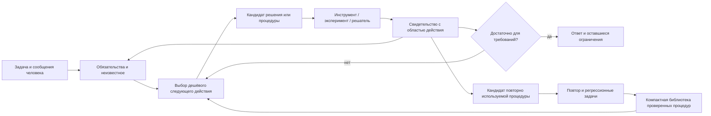

# Универсальный движок: гипотеза, архитектура и проверка

Исследование и состояние реализации: 30 октября 2026. Это проектное решение, а не
утверждение о достигнутом качестве флагманской модели. Под «малой» здесь понимается
**не более 10B всех параметров**, а не только активных параметров MoE. Веса, KV,
время, стоимость и потребление памяти учитываются отдельно.

## Что позволяют заключить исследования

| Работа | Что существенно для проекта | Граница вывода |
|---|---|---|
| [Life-Harness, v3](https://arxiv.org/html/2605.22166v3) | Для Qwen3-4B изменение контрактов среды, процедур, исполнения действий и восстановления существенно улучшило результаты; готовые harness переносили на другие модели | Обвязку разрабатывала GPT-5.5 по обучающим траекториям. Это полезный результат малой модели при исполнении, а не автономное самоулучшение исключительно силами 4B. Среды преимущественно детерминированные, текстовые/API |
| [Better Harnesses, Smaller Models](https://arxiv.org/html/2607.08938v1) | Адаптация закрыла разрыв с сильной базовой системой в 7 из 21 сочетания задачи и модели; важны процедуры, сокращение инструментов, восстановление | Семь деловых процессов, оптимизатор Gemini 3.1 Pro, $20 на адаптацию сочетания. Две модели имеют 26B/30B полных параметров при меньшем числе активных. Не доказательство всеобщего лидерства десктопной 9B |
| [TTHE, v2](https://arxiv.org/html/2607.08124v2) | Исполнитель, автор harness и судья используют один frozen backbone. Сохраняемые изменения исполняемой программы дали улучшения на шести наборах задач. В BIRD десятикратное повторение фиксированной процедуры заметно уступало её адаптации | Основной backbone DeepSeek V4 Flash, а не 9B. Сопоставление числа запусков не выравнивает полностью токены, инструменты, поиск и судейство. Исполняемый результат может быть семантически неверным; перенос проверялся в ограниченных условиях |
| [VeriHarness](https://arxiv.org/html/2610.00972v1) | Проверять разногласия через новые свидетельства и отдельно пытаться опровергать единодушные ошибки. Проверяющий может использовать ту же модель, получая собственные инструменты и контекст | Эксперименты на сильных моделях и дорогом пуле траекторий; голосование и модельное ревью не становятся гарантией истинности |
| [Meta-Harness](https://arxiv.org/html/2603.28052v1) | Оптимизация исполняемого harness по исходникам и полным журналам, доступным через файловый поиск; не нужно вставлять весь архив в каждый запрос | Дорогой внешний поиск. Воспроизведение этого процесса на каждом пользовательском запросе противоречит цели компактности |
| [Harness²](https://arxiv.org/html/2610.14224v1) | Propose–Probe–Compose и библиотека сохраняемых изменений; отдельная адаптация текущей работы и механизма будущей адаптации | Авторы прямо оговаривают цену рекурсии, коррелированные ошибки и отсутствие гарантии переноса принятого изменения |
| [What Does a Harness Buy?](https://arxiv.org/html/2610.04433v1) | При контролируемом сравнении существующих coding-harness замена обвязки не давала стабильного большого выигрыша по решённым SWE-задачам, зато существенно меняла расход | Сравнивались конкретные готовые системы и модели. Это предостережение против недостоверных сравнений, не запрет на новые алгоритмы поиска и проверки |
| [Rethinking Verification](https://arxiv.org/html/2610.34577v1) | Независимый критик с доступом к рабочей среде в среднем выгоднее многих напоминаний и обязательных повторных проверок. Дополнительная проверка должна находить конкретные дефекты | Семь сильных coding-моделей; средние результаты не гарантируют выигрыш для 9B или любого отдельного режима |
| [DecisionRAG](https://arxiv.org/html/2610.35868v1) | Иерархический отбор источников, совместная оценка кандидатов в общем контексте, решения без авторегрессивного вывода | Быстрые основные результаты относятся к Jev API. Вариант Qwen3-8B имеет обученную scoring-head. Ошибочное отсечение предка теряет полезные документы; latency разных платформ нельзя переносить на Mac |

Работы выше преимущественно препринты. Их результаты нельзя складывать как независимые
прибавки к качеству, переносить на наши модели без измерения или выдавать за воспроизведённые.

**Инженерная гипотеза:** универсальным может быть механизм построения и проверки решения;
процедуры, которые он создаёт во время работы, будут специализированными. Изменение
промпта — лишь один доступный приём. Другие: новый исполняемый инструмент, поиск
контрпримера, изменение представления задачи, точный решатель, процедура восстановления.

## Единица работы — проверяемое обязательство

Целевая структура состояния должна связывать:

`требование → утверждение/гипотеза → зависимости → проверка → свидетельство → артефакт`.

Утверждение содержит предпосылки, область применимости, источник, версии зависимостей и
статус: proposed / contradicted / supported / unresolved. Нельзя использовать один флаг
`verified` для математического доказательства, сотни случайных тестов и мнения критика.
Проверка сообщает, что именно установлено, каким средством и при каких условиях.

| Задача | Кандидат | Следующее различающее наблюдение | Что остаётся непроверенным |
|---|---|---|---|
| Ошибка программы | Маленький patch | Воспроизведение до правки, затем регрессия и существующие тесты после неё | Поведение вне покрытия тестов |
| Алгоритм | Процедура и инвариант | Сравнение с полным перебором на малых входах, контрпример, проверка инварианта | Общая корректность и асимптотика без отдельного аргумента/формализации |
| Математика | Формула или доказательство | Точные преобразования, проверка предпосылок, контрпример; при формализации — проверка ядром | Неформализованные шаги и соответствие формальной постановки исходной |
| Исследование | Утверждение о мире | Первичный источник, независимый источник, пересчёт исходных данных | Наблюдаемость, полнота и актуальность источников |

Базовый граф уже реализован в `src/coding/obligations.py`: контракт, утверждения,
зависимости, evidence-id и версии файлов. Изменения делают прежнюю поддержку устаревшей;
модельное ревью отделено от предложений агента. Автоматического логического вывода и
формального доказателя нет. Инвалидация ревью пока консервативна: учитывает весь набор
исходников, а не только минимальный набор семантических зависимостей.

## Один цикл и адаптируемые процедуры

Малая модель предлагает локальные решения и объяснения. Исполнение, точные расчёты,
сохранение состояния, отслеживание версий и механические ограничения выполняет код.
Сложная работа разбивается по размеру необходимого контекста и границам проверки,
а не по произвольному количеству «личностей».

Смена мышления означает смену стратегии, разрешённого набора инструментов и условия
выхода при сохранении рабочего состояния. Для смены между исследованием, исполнением,
контрпримером и ремонтом нужны разные процедуры; переименование роли само по себе
не создаёт новую способность. Инструкции не могут расширять полномочия среды.

Делегирование полезно при независимых поисковых направлениях, узком контексте или
независимой проверке. Каждая ветка получает свою неопределённость и критерий выхода.
Соседи обмениваются утверждениями со свидетельствами; полные истории не транслируются
всем участникам. Наблюдатель смотрит события бесплатно; модельное вмешательство нужно
при ошибке, противоречии, утрате контекста или отсутствии прогресса.

Контрпример сильнее нескольких согласных отзывов. Проверяющий сначала пытается
опровергнуть наиболее существенное утверждение и проверяет пропущенные требования,
а не повторяет цепочку обоснования автора. Разные контексты полезны для распределения
внимания, но не делают ошибки одинаковой модели статистически независимыми.

## Два темпа обучения вне весов

**Во время задачи:** подобрать известную процедуру, сделать ограниченный probe, получить
свидетельство, исправить решение. Дорогое самоизменение не нужно для обычной успешной работы.

**Между задачами:** по повторяющимся сбоям предложить минимальное изменение процедуры;
повторить исходный сбой, проверить соседние случаи и старые успешные сценарии; сохранить
версию и возможность отката. Новые скрипты проходят ту же проверку исполнения и полномочий,
что остальные инструменты. Успешный публичный тест не даёт права запомнить ответ benchmark.

Элемент библиотеки: trigger, предпосылки, процедура/скрипт, интерфейс входа и выхода,
свидетельства, тесты, известные провалы, стоимость, версия среды. Непроверенный урок остаётся
гипотезой. Few-shot — короткий вызов процедуры и наблюдённый результат, а не длинный монолог.
При многократном использовании выгоднее вынести последовательность действий в проверенную
функцию, чем каждый раз генерировать её заново. Это обучение программы, хотя веса заморожены.

## Расход и десктопный режим

По умолчанию работает одна активная ветка. Усложнение включается условно: обнаружена
ошибка, конкурирующие гипотезы требуют различающей проверки или одна независимая
ветка сокращает основной контекст. Параллельность на одном GPU не означает ускорение;
она может увеличить KV и замедлить все запросы.

Выбор действия в перспективе должен учитывать ожидаемое сокращение неопределённости,
стоимость и риск регрессии. Сейчас такой калиброванной оценки нет: используются границы
бюджета и эвристики. Не следует изображать модельную уверенность численной вероятностью.

В запрос попадают актуальная цель, обязательные ограничения, текущий фронт работы,
несколько относящихся к нему свидетельств и процедур. Архив остаётся доступен поиском.
«Было найдено» и «передано в текущий запрос» — разные состояния. Точный KV-prefix cache
ускоряет одинаковые префиксы; он не объединяет знания разных контекстов и моделей.

На локальном профиле ≤10B важны весовой квант, длина контекста, KV, prefill и число
активных запросов. Низкий расход токенов не гарантирует низкую задержку и температуру.
2-bit и 4-bit нужно сравнивать на одном harness и одинаковом наборе задач.

## Состояние этого репозитория

Реализованы единый цикл `src.harness.Harness` (совместимый импорт `src.coding.CodingHarness`),
`sea solve` / `sea code`, профили и смена состояния без потери памяти, steering, изолированные
правки дочерних веток с проверяемым принятием, bounded observer, проектные заметки,
учёт фактически переданного контекста, точные SymPy-операции и scratch-эксперименты Python/C++.
Чистая математическая/алгоритмическая задача получает профиль без записи в исходники.
`--same-model` использует один выбранный адаптер также для решений и критики.

Добавлены граф требований/утверждений/evidence (`obligations.py`), активные пробы критика
(`verifier.py`) и навигация по контексту с сохранением альтернатив (`navigation.py`). Граф
инвалидирует поддержку при изменении файлов, свидетельств, зависимостей или операторских
ограничений. Предложения агента не становятся доказанными от одного вызова `claim`.
Критик читает исходники и запускает собственные проверки в одноразовой копии, затем
оценивает также корректность тестового оракула. Положительный результат остаётся оценкой
модели, а не гарантией. В дешёвых облачных проверках реально обнаружены и исправлены
ошибки привязки evidence, лишние требования создавать тестовые артефакты и потеря
результатов проб при исправлении только текста ответа.

Обычный выбор когнитивного режима теперь выполняет typed decision-контроллер; отдельная
генеративная модель нужна для новой стратегии/разбиения. Неоднозначное решение сохраняет
текущий профиль. Дочерние результаты удерживаются в ограниченной сводке, даже когда
исчезают из окна последних инструментов. Домены и формат ответа обязательны в модельной
схеме контракта; невалидный контракт допускает один оплачиваемый повтор без потери требований.
Дешёвый decision-вызов снижает накладные расходы управления, но не устраняет ошибки самого
исполнителя/проверяющего: сквозная серия на облачной 9B выявила повторы и ошибки JSON,
а после исправлений пока подтверждён лишь отдельный небольшой алгоритмический сценарий.
Сценарии и отрицательные результаты описаны в [инженерных проверках](local_coding_harness.md).

## Исполняемая конструкция общего ядра

Это один цикл с адаптерами свидетельств, а не отдельный агент на каждый benchmark:

`запрос + steering → контракт → состояние → допустимые действия → исполнитель → наблюдение → проверка → завершение/ремонт`.

1. **Контракт (`critic.py`).** Модель выделяет требования, домены и формат ответа. Дополнительное
   механическое условие обязано содержать дословную цитату запроса. Невалидная структура допускает
   один ограниченный повтор. Цитата устанавливает происхождение условия, но сама по себе не доказывает,
   что модель правильно истолковала пользователя. Поведение, тестовый артефакт и принятие worker patch
   разделены; независимое ревью не означает обязательное принятие чужого кода.
2. **Состояние (`minds.py`, `obligations.py`).** Исходники, версии, требования, наблюдения, сводки
   и результаты дочерних задач сохраняются отдельно от текущего промпта. Ребёнок получает свою задачу
   и уже прочитанный исходник; глобальная задача родителя не становится его вторым заданием. Смена
   режима сохраняет память, но не повышает исходные полномочия read-only ветки.
3. **Множество действий (`orchestration.py`, `progress.py`).** Схема запроса содержит только действия
   текущего шага: исчерпанные делегирования и повторные планы убираются. `finish` недоступен,
   пока механические условия контракта не выполнены; конкретные препятствия передаются в контексте.
   После двух одинаковых
   предложений без новых наблюдений временно исключается соответствующий инструмент/тип действия.
   Новое свидетельство, изменение файлов или steering снимает ограничение. Это эвристика: она может
   потребовать другого наблюдения перед корректным повтором; оптимальность такого поиска не доказана.
4. **Исполнение (`harness.py`, `worktools.py`).** Все действия повторно проверяются кодом. Источник
   истины о выполнении — реальный результат инструмента. Software использует правки, diff и checks;
   математика — точные операции; алгоритмы — исполняемые эксперименты. Новые предметные области
   могут добавлять адаптеры проверок, не переписывая цикл. Формальные доказатели пока отсутствуют.
   Ссылки рабочего контекста ведут на записи evidence, а UUID отдельных subprocess-логов хранятся
   внутри этих записей: эти два пространства идентификаторов не взаимозаменяемы.
5. **Проверка (`critic.py`, `verifier.py`).** Сначала бесплатные необходимые условия: формат ответа,
   наличие запрошенных файлов/тестов, актуальность checks, принятие требуемых worker patches. Только
   затем оплачиваются независимые probes и семантическая оценка. Ошибка API/аргументов проверяющего
   отличается от контрпримера; снять такой провал можно только явным разбором и успешным замещающим
   наблюдением. Это модельная оценка связи свидетельства с утверждением, не формальная гарантия.
6. **Бюджет и наблюдение.** События не требуют LLM. Decision-модель выбирает из конечных вариантов,
   генеративный planner вызывается условно. Общие ограничения на ветки/глубину не умножаются рекурсией.
   Цена, токены, контекстные receipts и фактически использованный облачный endpoint сохраняются.

`request.py` убирает повторные тексты исходников и старые вердикты из рабочего запроса, сохраняя
задачу, ограничения и ссылки на полные журналы. Альтернативный `native_tools.py` компилирует тот же
набор действий в function calls и передаёт до двух реально выполненных коротких наблюдений как
assistant/tool messages. Усечённые аргументы не превращаются в вымышленные выполненные вызовы.
Нативный протокол остаётся opt-in: текущие опыты не показали устойчивого выигрыша для 9B.

Такое разделение выносит память, управление правами, точные вычисления и часть контроля из
нейросети в программу. Оно **не выносит автоматически** способность находить нужную гипотезу,
правильно интерпретировать задачу или проверять неформальное доказательство. Это остаётся главным
неподтверждённым звеном гипотезы о качестве флагмана при ≤10B.

Остаются исследовательские задачи:

1. Проверяемая компиляция новых процедур и их регрессионное принятие; сейчас библиотека в основном текстовая.
2. Измеряемое распределение бюджета вместо ручных порогов и калибровка ошибок проверяющего.
3. Единая поверхность с прежним LangGraph-графом: пока новый цикл и старый ассистент выбираются отдельно.
4. Полноценная иерархия документов/фрагментов и локальный обученный scoring-head: текущая
   навигация группирует проектные заметки, общий контекст и сохранённые процедуры.

SymPy не заменяет Lean/Isabelle/SMT. Эти адаптеры и проверка формальных доказательств
пока не реализованы. Linux-контейнерный benchmark использует отдельный файловый backend;
в нём ещё нет полноценных записываемых дочерних snapshots, доступных в нативном backend.
Активный критик в этом backend использует только инструменты чтения контейнера;
локальная копия его метаданных никогда не используется как исполняемый проект.

## Исполняемая проверка ответа — 31 октября 2026

В `answer_verification.py` реализован ещё один общий слой: связывание результата проверки
с **фактически выдаваемым ответом**, а не с похожим расчётом из предыдущего шага.
В диагностических прогонах модель правильно вычисляла путь в инструменте, но возвращала
другой путь; в другом случае переименовывала обязательное поле. Текстовый критик это пропускал.

Текущая конструкция для математического/алгоритмического JSON-ответа:

1. Контракт сохраняет явно заданные ключи. Поддерживаемая синтаксическая запись ключей
   копируется в схему, остальные формулировки разбирает модель. Финальный объект декодируется
   как объект, а для UI/checkpoint сериализуется в прежнюю строку. Новое сообщение оператора
   может отменить старый формат. Парсер не претендует на полное понимание естественного языка.
2. Отдельный проверяющий получает исходную задачу и имена вычисляемых полей, **без значений
   кандидата, его заметок и рассуждений**. Он создаёт исполняемую проверку в изолированной копии.
   Один backbone может выполнять обе роли; это устраняет прямое подглядывание, но не корреляцию ошибок.
3. Проверяющий возвращает типизированный объект `{code, outputs, limitation}`. `code` вычисляет
   значения, а обязательный `outputs` связывает каждое проверяемое поле с Python-выражением
   или именем вычисленной переменной. Для неединственного свидетельства указывается имя
   функции проверки допустимости и оптимальности. Схема требует все имена полей; runtime
   исполняет выражения, сериализует точные дроби и сравнивает результат с фактическим ответом.
   Модели не нужно вспоминать специальный вызов экспорта или самостоятельно сериализовать JSON.
   Прежние `EXPECTED`/`VALIDATORS` и функции `check`/`verify` совместимы с сохранёнными программами.
   Значение кандидата передаётся функции только при исполнении уже созданного проверяющего.
4. При смене ответа сравнение выполняется заново. Результат predicate привязан к хэшу проверенного
   значения; для другого свидетельства повторно исполняется тот же код без новой генерации LLM.
   Противоречие блокирует завершение до текстового ревью. Проза оценивается отдельно.
5. Ошибка проверяющего допускает один ограниченный ремонт с его исходным кодом и последней
   строкой traceback. Сохраняется различие между ошибкой инструмента и контрпримером.
   Ошибки API сохраняют checkpoint, код HTTP и очищенную диагностику вместо аварийного завершения.
6. Если исполняемый oracle противоречит кандидату, допускается один дополнительный расчёт
   другим методом в том же общем бюджете. Он получает задачу и предыдущую программу, но не
   значения ответа кандидата. Обе программы и наблюдения сохраняются. Если оба расчёта отвергают
   ответ, текстовое ревью не может его принять. Если один совпал, ревью обязано назвать конкретную
   ошибку другого и сослаться на успешный альтернативный расчёт. Смена ответа заново связывает
   оба результата и их evidence ID без новой генерации; смена исходников/задачи сбрасывает кеш.

Первое вычисление и извлечение требований остаются на low. При ремонте oracle или независимом
пересчёте конфликтующего результата используется явный выбор reasoning оператора; в режиме auto
по умолчанию — medium (настраивается через `critic.repair_reasoning`). Общие ограничения цены,
токенов и количества вызовов сохраняются. Это выбор усилия на этапе восстановления, без смены
модели и без фонового опроса.

Финальное семантическое ревью по умолчанию остаётся на low: повышение reasoning в диагностике
9B неоднократно расходовало весь лимит вывода без JSON-вердикта. Для отдельного эксперимента
можно задать `critic.review_reasoning: medium|high|operator`; `operator` следует выбору пользователя.
В ревью явно разделены конечные числовые проверки и общие утверждения об алгоритме/сложности.
Другой алгоритм oracle допустим; сам по себе он не опровергает решение и не доказывает его общий
аргумент. При повторном ревью исторические кандидаты, старые сравнения oracle и прежние вердикты
не подмешиваются к текущему ответу. Полный журнал сохраняется; ссылки на доказательства ревью
ограничены текущими наблюдениями и исходными действиями исполнителя.
Wire-схема ревью требует только ID каждого критерия; исходный текст требования присоединяет
runtime. Сообщения об ошибках ограничены 500 символами, чтобы не расходовать лимит вывода
на повторение уже переданного контракта. Это сокращение формата, а не сокращение проверяемых
требований. Семантическое качество модели всё равно проверяется отдельно.
Непустой список незакрытых замечаний блокирует завершение даже при `ready=true`; точные
пустые обозначения вроде `None` нормализуются. Это проверка согласованности вердикта, а не
замена проверки его содержания: при отсутствии замечаний модель всё ещё может ошибиться.

Это включено через `coding.orchestration.critic.answer_verification: true`. Оно применяется
к вычисляемым JSON-полям в native workspace; ошибочная метка `software` не отключает его,
если workspace пуст, нет зарегистрированных проверок, изменений и требований к артефактам.
При наличии исходников/проектных обязательств сохраняется проверка поведения проекта — числовой
отчёт не заменяет её. Текстовые ответы и удалённый контейнер сохраняют
прежний режим ревью. `adaptive_tools` и native function transport остаются экспериментальными:
измерения не дали основания включать их по умолчанию.

Ограничения существенны. Модель может написать неверный oracle или predicate; исполнение не
доказывает соответствие исходной задаче. Проверка AST на использование вычисленных переменных
и аргумента predicate — эвристика против наблюдавшихся ошибок, а не доказатель и не sandbox.
Форматы отдельных значений и объяснения частично зависят от семантического ревью. Проверяющий
может ошибочно задержать правильное решение: это произошло в SQLite-сценарии из-за его собственного
неверного `BEGIN` внутри открытой транзакции. Правильные проверки кандидата не дают права скрыть
этот незакрытый вопрос или объявить весь процесс завершённым.

Software-проверяющий теперь допускает один ограниченный ремонт своего исполняемого кода.
Исходная ошибка остаётся в журнале; успешная замена сама по себе не снимает её. Семантическое
ревью должно явно связать ошибку oracle с успешным заменяющим наблюдением. Точные замены
не должны удалять исходные assertions/imports; это эвристика сохранения проверки, не доказательство
эквивалентности. Неверная реализация кандидата продолжает блокировать завершение в регрессии.

У 9B дополнительно сокращена схема планирования: только список шагов, без отдельного длинного
summary. Корневая делегация по умолчанию требует плана и хотя бы одного фактического наблюдения;
это предотвращает немедленное перекладывание всей задачи на дочерний цикл. Порог настраивается
через `root_delegation_min_observations` (0 отключает эту эвристику). Это не проверка качества
декомпозиции: модель по-прежнему может выбрать неудачную подзадачу после первого наблюдения.

Незакрытые механические требования сопровождаются конкретным следующим действием: добавить
запрошенные регрессионные тесты, создать заданный файл или вызвать `check` с реальным именем
зарегистрированной проверки. Обычный `run`, включая запуск подмножества тестов, не засчитывается
за полную зарегистрированную проверку; вывод явно сообщает об этом. Подсказки не создают новых
обязательств и не являются доказательством качества написанных тестов.

Следующие приоритеты качества: выполнение всех требований задачи малой моделью, перенос на
независимые публичные задачи при равных бюджетах и измеряемое распределение бюджета проверок.
Число режимов и тестов инфраструктуры само по себе не измеряет способность решать задачи.

После повторного падения одного registered check корневой агент и рабочие ветки получают
отдельную ограниченную диагностику: исходная задача, текущие указания, провал проверки и
выдержки текущего кода. Она пытается различить ошибку реализации, ожидания теста, окружения и
недостаток данных. Это непроверенная гипотеза без поля `ready`; она не исправляет файлы,
не отменяет проверки и не считается свидетельством корректности при завершении. `assess`
по-прежнему блокирует завершение на непрошедшем registered check.

Один диагностический вызов разрешён на узел/проверку/задачу/указания оператора; правки кода
не сбрасывают лимит. Попытка сохраняется до запроса, включая случаи неправильного JSON и
возобновления сессии. Используется общий бюджет критика с резервом на итоговый probe/review
и ещё один вызов, если контракт требований не извлечён. Устаревший результат после изменения
исходников или указаний отбрасывается; чужие evidence ID не принимаются. Режим `same_model`
сохраняется, дополнительного сильного диагноста нет.

При включённом `critic.active` и доступном native probe тот же диагностический вызов
может составить короткую Python-программу, которая печатает реальные результаты и состояния
после операций. Программа исполняется в одноразовой копии с прежним лимитом 15 s. Изменение
любого исходного файла этой копии делает наблюдение непригодным; исходный проект не меняется.
Если эксперимент выполнен, исполнитель получает код и наблюдения без предварительного
модельного диагноза: мнение, сформированное до запуска, сохраняется в журнале, но не выдаётся
за интерпретацию полученного результата. Наблюдения могут опровергать исходную гипотезу и
не являются доказательством выполнения задачи. Дополнительная сильная модель не вводится.

Последняя ошибка хранится отдельно от короткого окна `recent` и переживает чтения других
файлов и resume. После изменения исходников она помечается исторической и требует перепроверки;
после новых указаний оператора не подмешивается в новый контекст. После редактирования агент
сразу получает ограниченную свежую выдержку файла. Устаревшие советы диагноста удаляются
из рабочего контекста. Повторное планирование без новых свидетельств не предлагается схемой.
Все эти механизмы применяются к корню и рабочим веткам; полноценный успех задачи всё ещё
зависит от правильной интерпретации наблюдений моделью.

Timeout команды сохраняет последние 24 KB вывода, идентификатор полного лога и команду,
явно помечая результат частичным и неуспешным. Python-эксперименты используют unbuffered
stdout и снимок Python-стека перед прежним жёстким лимитом 15 s. Для зависания внутри
нативного вызова стек может показать только вызывающую Python-строку. Убийство группы
процессов и ограничения песочницы сохраняются. Это улучшение диагностики, а не доказательство
роста доли решённых задач; модель всё ещё может неверно интерпретировать свидетельства.
Python `experiment` импортирует модули текущего проекта напрямую; переносить в `sys.path`
временные пути проверочных копий из traceback не нужно. Защита исходного проекта от записи
сохраняется; математический subprocess с `-I` остаётся изолированным от импорта проекта.

Эксперимент ремонта нового теста отделяет четыре шага: спецификация → независимо
сгенерированная исполняемая reference-программа → вычисленные значения → механическая
привязка значений к конкретным assertions. Исполнителю не требуется заново угадывать эти
значения при свободном переписывании кода. Это продолжение уже используемой идеи привязки
точных математических результатов к финальному ответу. На одном известном LRU replay
Qwen 9B исправила ошибочные новые ожидания за 397 токенов; прямое предсказание значений
и свободная правка ранее не справились. Это ограниченное свидетельство в пользу подхода,
не оценка переноса. Для исходных тестов, fixtures, сложного control flow и других языков
автоматическая привязка пока не реализована. Для поддерживаемых новых unittest-методов
добавлен опциональный путь `critic.reference_repair`, выключенный по умолчанию: сохранённая
история исходников и инструментальных правок подтверждает происхождение метода, все
registered checks сначала выполняются в частной копии, а устаревшие результаты отбрасываются.
Он использует существующую квоту диагностики, не отменяет итоговую проверку и не меняет
исходные методы тестов. Офлайн интеграционные проверки проходят; два новых облачных
сценария получили HTTP 429 до генерации, поэтому перенос на них пока не измерен.
Две одинаково ошибающиеся программы остаются возможными, поэтому нужны независимые
проверки, контроль происхождения исходных тестов и измерение ложных исправлений.

Исчерпание вывода теперь отделено от неправильного JSON: `finish_reason=length` либо
невалидный ответ с израсходованным `max_tokens` вызывает `OutputBudgetExceeded`, учитывает
стоимость и останавливает соответствующий проход с checkpoint. Обрезанный tool call не
исполняется, даже если его аргументы успели составить валидный JSON. Сохраняются finish reason,
размер видимого ответа, лимит и известные reasoning tokens; отсутствие счётчика отмечается
как неизвестность. Обычный невалидный JSON ниже лимита сохраняет прежний механизм исправления.
По умолчанию эта обработка сохраняет checkpoint. Опциональный `output_recovery` может
один раз попросить ту же модель завершить структурированное действие на основании реально
возвращённого черновика, в том же общем бюджете. Черновик не считается свидетельством,
обрезанные действия не исполняются; обязательное reasoning и вызовы критика исключены.
Режим пока проверен офлайн и не подтверждает роста качества решений.

Параметры reasoning учитывают метаданные модели: отсутствие `supported_efforts` означает
включение reasoning через `enabled`, а не обещание различных уровней medium/high. Это следует
из [описания OpenRouter](https://openrouter.ai/docs/guides/best-practices/reasoning-tokens).
Ограничение reasoning через `max_tokens` доступно не всем моделям; универсальная жёсткая
граница thinking-токенов без поддержки провайдера не заявляется.
Ложное отклонение математического/алгоритмического кандидата неверным oracle воспроизведено
в регрессии: повторная релаксация Bellman–Ford завышает число кратчайших путей, тогда как
перебор считает каждый путь один раз. Ограниченное разрешение такого противоречия теперь
реализовано; неправильный кандидат, отсутствие явного разрешения, чужие evidence ID и два
провалившихся расчёта остаются блокирующими случаями. Это контроль ошибок, а не доказатель:
оба oracle и семантический ревьюер могут ошибиться одинаково. Отдельная сильная модель не
подмешивается в режим `same_model`.

## Как подтвердить гипотезу

Общий цикл не требует от каждого облачного backend серверного constrained decoding:
`structured_output=auto` выбирает JSON Schema, JSON mode или текстовый JSON по заявленным
capabilities, а локальные проверки схемы и допустимости действий сохраняются. Ограниченный
общий бюджет повторов временных отказов с `Retry-After` не умножается на число ролей.
Это условия переносимости и доступности, а не доказательство прироста интеллекта.
Размер модели, endpoint, формат ответа, повторные запросы, задержки и все расходы должны
оставаться видимыми в сравнительных прогонах.

Нужны три явно различных режима: все роли на одной ≤10B; сильная модель только при
предварительном создании процедур; гибрид со сильным критиком во время исполнения.
Стоимость создания библиотеки отчётна отдельно и амортизируется, а не исчезает из счёта.

Для одного frozen checkpoint сравниваются минимальный цикл, цикл с инструментами,
с состоянием/evidence, с условным поиском и с проверенной библиотекой. Равны задания,
число попыток и ограничения; дополнительно сравниваются кривые качества по времени,
токенам и деньгам. Все вызовы контроллера, критика, сабагентов и отменённые потоки учитываются.

Проверочные семейства: SWE-bench Verified, Terminal-Bench, алгоритмические задачи с
независимыми тестами, точная математика и отдельно формальные доказательства. Нужен
отложенный набор, на котором harness и библиотека не подстраивались. На небольшом наборе
нужны повторения и интервалы неопределённости, а не «высокий процент» из двух примеров.

Первичная метрика — доля независимо решённых задач при заданном бюджете. Рядом: цена
решённой задачи, задержка, число ложных завершений, peak RAM/VRAM и перенос между семействами.
Тесты репозитория проверяют рантайм; их количество не является баллом интеллекта агента.

Формальные зависимости, проверка присланной постановки и новые следствия для выбора
контекста: [совместная оптимизация](harness_optimization.md).
